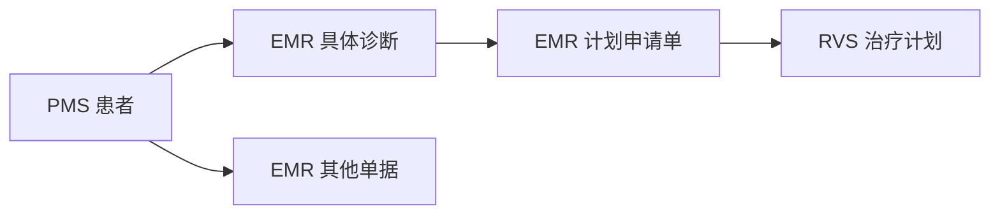

# OIS 全局搜索与临床条件筛选原型

通过统一入口查找患者、诊断、计划申请单、治疗计划和其他单据，并按明确的临床条件筛选患者、查看匹配依据。

## 文档

| 文档 | 内容 |
| --- | --- |
| [需求说明](docs/requirements.md) | 搜索范围、临床筛选口径、结果展示、异常及验收结果 |
| [设计说明](docs/design.md) | 原型架构、数据流、查询设计、同步及详情读取 |
| [表结构与索引](docs/data-model.md) | 三个数据库、五张业务表、字段约束及两种搜索投影 |
| [交互流程](docs/interaction-flows.md) | 搜索与筛选流程、页面线框、详情关联和返回行为 |
| [测试用例](docs/test-cases.md) | 虚构样例、预期结果及验收映射 |
| [OpenSpec change](openspec/changes/add-ois-search-clinical-prototype/proposal.md) | 提案、规格、设计依据和实施任务 |

## 数据关系



首版临床条件包括诊断、确认状态、诊断日期、年龄、性别和是否有关联计划。年龄按筛选当天计算周岁；“无关联计划”要求所有匹配诊断均没有关联计划。

## 原型组成

React/Umi 页面、本地 Node.js/TypeScript 只读接口、三个 PostgreSQL 原型库和 OpenSearch。数据使用虚构样例，修改后手动全量同步；详情读取数据库中的当前记录。

本仓库目前交付需求和设计文档，尚未创建业务数据库或实现可运行原型。实施步骤见 [tasks.md](openspec/changes/add-ois-search-clinical-prototype/tasks.md)。

检查规划文档：

```sh
openspec validate add-ois-search-clinical-prototype --strict
```
