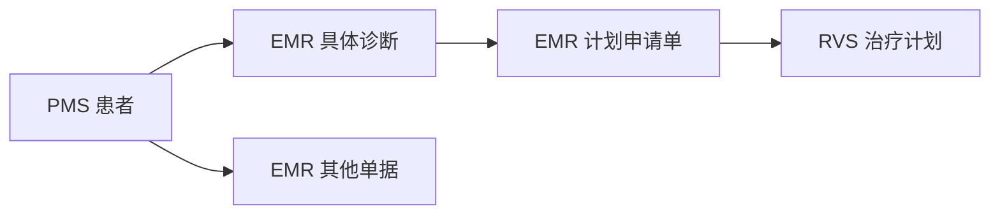

# OIS 全局搜索原型

通过统一入口查找患者、诊断、计划申请单、治疗计划和其他单据，查看命中内容，并打开原始记录及其关联详情。

原型已实现 React/Umi 页面、本地 Node.js/TypeScript 只读接口、三个独立 PostgreSQL 数据库和 OpenSearch 搜索。全部业务样例为虚构数据；基线包含 18 条源记录，排除已删除申请单和已作废计划后，可搜索记录共 16 条。实际验证结果见 [验证记录](docs/validation.md)。

## 本地启动

使用 Node.js 22（`.nvmrc` 固定为 `22.22.3`）、npm 和可运行 Docker Compose 的 Docker 引擎。以下命令均在仓库根目录执行；使用 nvm 时先切换版本：

```sh
nvm install
nvm use
node --version
npm ci
[ -f .env ] || cp .env.example .env
```

本机使用独立的 Colima 环境和 Docker context `colima-ois-search`。如该环境已停止，先运行 `colima start ois-search --activate=false`，再运行：

```sh
DOCKER_CONTEXT=colima-ois-search npm run infra:up
docker --context colima-ois-search compose ps
```

在其他机器上，使用已启动的 Docker context 运行 `npm run infra:up` 即可。Compose 启动 PostgreSQL 16.11 和 OpenSearch 3.9.0，并等待两个服务健康。

首次创建并导入样例：

```sh
npm run db:init
npm run db:seed
npm run sync
```

`db:init` 可重复执行，会保留已有记录。`db:seed` 仅向空库导入，已有记录时明确拒绝覆盖。本机已经完成初始化和同步，日常启动可直接执行：

```sh
npm run dev
```

打开 [全局搜索页面](http://127.0.0.1:8107)。开发命令同时启动页面和接口；服务地址如下：

| 服务 | 地址或端口 |
| --- | --- |
| React/Umi 页面 | [http://127.0.0.1:8107](http://127.0.0.1:8107) |
| 本地接口 | [健康检查](http://127.0.0.1:4107/api/prototype/health)、[同步状态](http://127.0.0.1:4107/api/prototype/index-status) |
| PostgreSQL | `127.0.0.1:54329`，独立数据库 `pms_demo`、`emr_demo`、`rvs_demo` |
| OpenSearch | [http://127.0.0.1:9207](http://127.0.0.1:9207) |

连接配置见 [.env.example](.env.example)，本地修改保存在 `.env`。数据库名固定为三个原型库，初始化、导入和查询都会检查目标名称。

按 `Ctrl+C` 停止页面和接口。停止基础服务并保留 Docker 数据卷：

```sh
DOCKER_CONTEXT=colima-ois-search npm run infra:stop
```

## 搜索样例

以下结果基于初始样例，患者范围、来源和对象类型均选择“全部”。

| 关键词 | 预期结果 |
| --- | --- |
| `000123` | 林示例 P1 的 8 条记录 |
| `00123` | 同名患者 P2 的 4 条记录；前导零保留 |
| `林示例` | 两位同名患者的 12 条记录，按放疗号区分 |
| `屏气` | 申请单 R1、治疗计划 T1、单据 O4，共 3 条 |
| `鼻咽癌` | 诊断、申请单和单据共 7 条；疑似、已排除及家族史上下文保留 |
| `病理报告` | 单据 O1，明确标记单据类型命中 |
| `DEMO-NPC` | 诊断 D1、D3，展示虚构编码体系及版本 |
| `PLAN-002` | 治疗计划 T2；打开其来源申请单 R3 时提示已删除 |

可按来源和对象类型筛选，也可明确切换到某位患者的范围。搜索“屏气”后选择 EMR，可看到 R1、O4；再选择“其他单据”，列表只保留 O4。

## 数据关系



每条记录按来源、类型和 UUID 定位。诊断详情列出来源单据、申请单及其治疗计划；申请单和计划可沿保存的关联回看原记录。正文提及某个诊断词，仅作为文本命中展示。

## 手动同步和恢复样例

修改虚构源数据后，先停止继续写入，再执行：

```sh
npm run sync
```

同步脚本读取三库、校验引用和患者一致性，完整写入新索引后切换 `ois-records` 查询别名。发布前失败时继续使用上一批完整数据。运行结果保存在 `.runtime/sync-state.json`，页面可读取当前批次及最近同步状态。

搜索结果保持在查询时的批次，详情读取数据库中的当前记录。同步后在页面重新查询，即可使用新批次。

恢复初始样例会清除三个原型库中的现有业务记录，然后重新导入基线；需显式使用 `--reset`：

```sh
npm run db:seed -- --reset
npm run sync
```

验证分页时，可恢复基线并增加 25 份分页单据：

```sh
npm run db:seed -- --reset --pagination
npm run sync
```

搜索“分页唯一词”应得到 25 条结果，两页分别为 20 条、5 条。完成后用上面的基线恢复命令还原样例。

## 验证

```sh
npm run typecheck
npm run test:unit
npm run test:integration
npm run build
```

单元测试验证数据投影、关联、查询参数和命中片段。集成测试要求三库已初始化且 Docker 服务可用，会修改并恢复虚构样例、发布搜索批次，验证完整搜索、最新详情、同步变化、失败恢复和分页。`npm run build` 执行类型检查并构建页面。

浏览器场景及预期结果见 [测试用例](docs/test-cases.md)，实际结果见 [验证记录](docs/validation.md)。OpenSpec 校验：

```sh
openspec validate --all --strict
```

## 文档

| 文档 | 内容 |
| --- | --- |
| [需求说明](docs/requirements.md) | 搜索范围、结果展示、异常及验收结果 |
| [设计说明](docs/design.md) | 原型架构、数据流、查询设计、同步及详情读取 |
| [表结构与索引](docs/data-model.md) | 三个数据库、五张业务表、字段约束及记录搜索索引 |
| [交互流程](docs/interaction-flows.md) | 搜索流程、页面线框、详情关联和返回行为 |
| [测试用例](docs/test-cases.md) | 虚构样例、预期结果及验收映射 |
| [OpenSpec](openspec/) | 规格、提案、设计依据和实施任务 |
