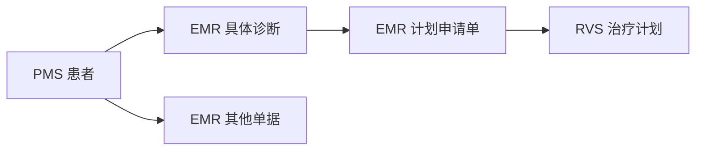

# OIS 全局搜索原型

在新电脑上安装依赖、启动服务和配置模型，请见[开发环境搭建说明](docs/developer-setup.md)。

通过统一入口查找患者、诊断、计划申请单、治疗计划和其他单据，查看命中内容，并打开原始记录及其关联详情。

原型已实现 React/Umi 页面、本地 Node.js/TypeScript 只读接口、三个独立 PostgreSQL 数据库和 OpenSearch 搜索。全部业务样例为虚构数据；基线包含 18 条源记录，排除已删除申请单和已作废计划后，可搜索记录共 16 条。实际验证结果见 [验证记录](docs/validation.md)。

## 本地启动

使用 Node.js 22（`.nvmrc` 固定为 `22.22.3`）、npm 和可运行 Docker Compose 的 Docker 引擎。以下命令均在仓库根目录执行；使用 nvm 时先切换版本：

```sh
nvm install
nvm use
node --version
npm ci
[ -f .env ] || cp .env.example .env
```

本机使用独立的 Colima 环境和 Docker context `colima-ois-search`。如该环境已停止，先运行 `colima start ois-search --activate=false`，再运行：

```sh
DOCKER_CONTEXT=colima-ois-search npm run infra:up
docker --context colima-ois-search compose ps
```

在其他机器上，使用已启动的 Docker context 运行 `npm run infra:up` 即可。Compose 启动 PostgreSQL 16.11、OpenSearch 3.9.0 和 OpenSearch Dashboards 3.9.0，并等待数据库与搜索服务健康。

首次创建并导入基线样例：

```sh
npm run db:init
npm run db:seed
npm run sync
```

保存当前搜索索引里的全部记录，并在以后一键装回。文件放在本机 `.runtime/`，不进入 Git，因为里面是已经同步过的业务记录：

```sh
npm run data:capture
npm run demo:data
```

在能连接 PMS 和 EMR 的开发环境，先重新同步，成功后再导出定位申请单的新字段。

```sh
SOURCE_MODE=real npm run sync
SOURCE_MODE=real npm run data:capture
```

默认导出到 `.runtime/captured-search.ndjson` 和 `.runtime/captured-search.meta.json`。NDJSON 中 `documentType` 为 `定位申请单` 的记录，在 `simulationSourceFields` 下分别保存这五个字段。

| EMR 字段 | 快照字段 |
| --- | --- |
| 治疗部位 | `treatmentSites` |
| 定位中心 | `localizationCenter` |
| 技术 | `technique` |
| 扫描备注 | `scanRemarks` |
| 固定备注 | `immobilizationRemarks` |

这五项保留 EMR 查询返回的原值和空值。现有正文检索继续使用合并文本。

小套虚构样例仍然可以单独生成。它只覆盖各类单据的例子，会清掉演示库并替换当前搜索结果：

```sh
npm run demo:data -- --sample
```

`db:init` 可重复执行，会保留已有记录。`db:seed` 仅向空库导入，已有记录时明确拒绝覆盖。本机已经完成初始化和同步，日常启动可直接执行：

```sh
npm run dev
```

打开 [全局搜索页面](http://127.0.0.1:8107)。开发命令同时启动页面和接口；服务地址如下：

| 服务 | 地址或端口 |
| --- | --- |
| React/Umi 页面 | [http://127.0.0.1:8107](http://127.0.0.1:8107) |
| 本地接口 | [健康检查](http://127.0.0.1:4107/api/prototype/health)、[同步状态](http://127.0.0.1:4107/api/prototype/index-status) |
| PostgreSQL | `127.0.0.1:54329`，独立数据库 `pms_demo`、`emr_demo`、`rvs_demo` |
| OpenSearch | [http://127.0.0.1:9207](http://127.0.0.1:9207) |
| OpenSearch Dashboards | [http://127.0.0.1:5607](http://127.0.0.1:5607) |

连接配置见 [.env.example](.env.example)，本地修改保存在 `.env`。数据库名固定为三个原型库，初始化、导入和查询都会检查目标名称。

按 `Ctrl+C` 停止页面和接口。停止基础服务并保留 Docker 数据卷：

```sh
DOCKER_CONTEXT=colima-ois-search npm run infra:stop
```

## 搜索样例

以下结果基于初始样例，患者范围、来源和对象类型均选择“全部”。

| 关键词 | 预期结果 |
| --- | --- |
| `000123` | 林示例 P1 的 8 条记录 |
| `00123` | 同名患者 P2 的 4 条记录；前导零保留 |
| `林示例` | 两位同名患者的 12 条记录，按放疗号区分 |
| `屏气` | 申请单 R1、治疗计划 T1、单据 O4，共 3 条 |
| `鼻咽癌` | 诊断、申请单和单据共 7 条；疑似、已排除及家族史上下文保留 |
| `病理报告` | 单据 O1，明确标记单据类型命中 |
| `DEMO-NPC` | 诊断 D1、D3，展示虚构编码体系及版本 |
| `PLAN-002` | 治疗计划 T2；打开其来源申请单 R3 时提示已删除 |

可按来源和对象类型筛选，也可明确切换到某位患者的范围。搜索“屏气”后选择 EMR，可看到 R1、O4；再选择“其他单据”，列表只保留 O4。

输入「最近三个月确诊鼻咽癌、处方不少于 20 次」可按患者查询。页面显示实际使用的确诊日期范围、诊断和处方分次数。固定样例中，放疗号 `000123` 的申请单为 20 个分次。样例确诊日期进入查询范围时会返回该患者。已有原型库先运行 `npm run db:init` 增加可空的分次数列，填写需要参与筛选的虚构申请单后再运行 `npm run sync`。

全局搜索也支持「最近10个月确诊鼻咽癌」。结果按患者显示，页面列出确诊日期范围和 ICD-10 / ICD-11 编码范围。已有索引可用 `npm run demo:data` 从已保存的快照重建筛选字段。

## 数据关系



每条记录按来源、类型和 UUID 定位。诊断详情列出来源单据、申请单及其治疗计划；申请单和计划可沿保存的关联回看原记录。正文提及某个诊断词，仅作为文本命中展示。

## 手动同步和恢复样例

修改虚构源数据后，先停止继续写入，再点击搜索页的「同步数据」，或在项目根目录执行：

```sh
npm run sync
```

两种入口读取三库、校验引用和患者一致性，完整写入新索引后切换 `ois-records` 查询别名。发布前失败时继续使用上一批完整数据。运行结果保存在 `.runtime/sync-state.json`，页面显示当前批次及最近同步状态。

搜索结果保持在查询时的批次，详情读取数据库中的当前记录。同步后在页面重新查询，即可使用新批次。

恢复初始样例会清除三个原型库中的现有业务记录，然后重新导入基线；需显式使用 `--reset`：

```sh
npm run db:seed -- --reset
npm run sync
```

验证分页时，可恢复基线并增加 25 份分页单据：

```sh
npm run db:seed -- --reset --pagination
npm run sync
```

搜索“分页唯一词”应得到 25 条结果，两页分别为 20 条、5 条。完成后用上面的基线恢复命令还原样例。

## 验证

```sh
npm run typecheck
npm run test:unit
npm run test:integration
npm run build
```

单元测试验证数据投影、关联、查询参数和命中片段。集成测试要求三库已初始化且 Docker 服务可用，会修改并恢复虚构样例、发布搜索批次，验证完整搜索、最新详情、同步变化、失败恢复和分页。`npm run build` 执行类型检查并构建页面。

浏览器场景及预期结果见 [测试用例](docs/test-cases.md)，实际结果见 [验证记录](docs/validation.md)。OpenSpec 校验：

```sh
openspec validate --all --strict
```

## 文档

| 文档 | 内容 |
| --- | --- |
| [需求说明](docs/requirements.md) | 搜索范围、结果展示、异常及验收结果 |
| [全局搜索说明](docs/search-guide.md) | 搜索流程、OpenSearch 概念、字段设计和扩展工作量 |
| [可搜索字段](docs/search-fields.md) | 当前能搜到的字段及匹配方式 |
| [设计说明](docs/design.md) | 原型架构、数据流、查询设计、同步及详情读取 |
| [集成环境接入守则](docs/integration-guidelines.md) | 真实数据源、字段与权限、索引发布及验收 |
| [表结构与索引](docs/data-model.md) | 三个数据库、五张业务表、字段约束及记录搜索索引 |
| [交互流程](docs/interaction-flows.md) | 搜索流程、页面线框、详情关联和返回行为 |
| [测试用例](docs/test-cases.md) | 虚构样例、预期结果及验收映射 |
| [OpenSpec](openspec/) | 规格、提案、设计依据和实施任务 |

### 本地搜索模型

搜索后端可在同一台机器启动本地 Python 推理进程。BERT 环境需要
`torch` 和 `transformers`，模型目录应包含微调后的权重和 tokenizer。
BGE 环境需要 `onnxruntime`、`numpy` 和 `tokenizers`，模型目录应包含
`model.onnx` 和 `tokenizer.json`。在部署环境按 `.env.example` 指定两套 Python
和模型目录，模型文件通过单独的部署包提供。设置 `SEARCH_MODELS=off` 可关闭模型。

本机试验目录存在时，后端会自动使用 `.runtime/bert-pilot` 的 BERT 和
`.runtime/combined-pilot/reranker` 的 BGE，BGE 的 Python 环境来自
`.runtime/hybrid-pilot/venv`。首次查询加载模型。搜索 OpenSearch 候选后，BGE
在当前页重排并返回相关正文，不需要为这项功能重建向量索引。
组合查询示例为「找成像方式为 CT、备注里说要趴着摆位的定位申请单」。
