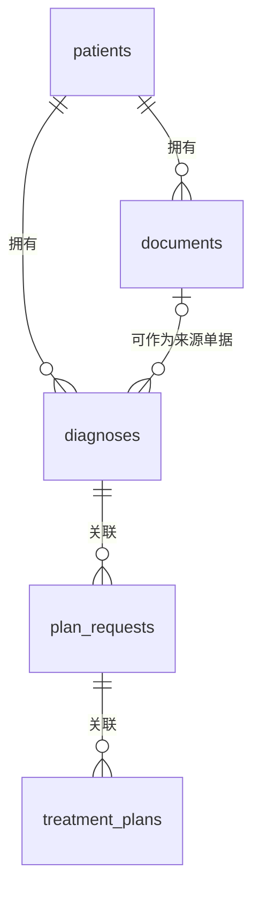

# OIS 搜索原型数据模型

原型用三个独立 PostgreSQL 数据库保存虚构的患者、诊断、计划申请单、其他单据和治疗计划，再生成用于全局搜索的 OpenSearch 记录索引。

表结构由 `scripts/schema/` 实现，索引映射由 `server/mapping.ts` 实现。业务条件见[需求](./requirements.md)，查询与回源流程见[交互流程](./interaction-flows.md)，验证场景见[测试用例](./test-cases.md)。

## 数据库与关系

| 数据库 | 表 | 内容 |
| --- | --- | --- |
| `pms_demo` | `patients` | 患者基本资料 |
| `emr_demo` | `diagnoses` | 每位患者的具体诊断记录 |
| `emr_demo` | `plan_requests` | 关联具体诊断的计划申请单 |
| `emr_demo` | `documents` | 其他单据及其正文 |
| `rvs_demo` | `treatment_plans` | 关联计划申请单的治疗计划 |

三个名称代表独立数据库，不是一个数据库中的三个 schema。数据库可以位于同一 PostgreSQL 实例；表之间不使用跨库外键。

每份计划申请单必须关联一条具体诊断；每个治疗计划必须关联一份计划申请单。申请单与计划同时保存 `patient_id`，用于校验整条关系属于同一患者。治疗计划通过申请单确定诊断，不另存一个可独立修改的 `diagnosis_id`。

`treatment_plans.plan_request_id` 使用非唯一索引；查询按实际保存的关联记录返回计划集合。

## 通用字段与可用性

五张表均包含下列字段；后续各表字段表列出其余字段。

| 字段 | PostgreSQL 类型 | 必填 | 含义与约束 |
| --- | --- | --- | --- |
| `id` | `uuid` | 是 | 主键；创建后保持不变，由数据生成或写入程序分配 |
| `created_at` | `timestamptz` | 是 | 首次写入时间；默认当前时间，后续更新不改动 |
| `updated_at` | `timestamptz` | 是 | 最近一次源记录修改时间；不得早于 `created_at` |
| `revision` | `bigint` | 是 | 记录版本，初始为 `1`，约束 `revision >= 1`；每次修改、软删除、作废或恢复时递增 |
| `deleted_at` | `timestamptz` | 否 | 软删除时间；空值表示未删除 |

诊断、申请单、其他单据和治疗计划另有 `voided_at timestamptz`，空值表示未作废。患者表不设置作废字段。

记录可用的统一条件为：`deleted_at IS NULL`，且该表有 `voided_at` 时还需 `voided_at IS NULL`。确认状态与计划状态不替代这个条件：例如诊断已排除，应记录 `confirmation_status = refuted`，不等于删除或作废。

软删除和作废保留源记录及关系，不级联修改子记录。可用患者下的源记录按自身可用性独立参与搜索；关联的诊断或申请单失效时，保留关联 UUID，打开目标时提示不可用，不拼接该目标正文。患者删除后，其全部记录退出搜索；恢复后由下一次完整同步重新检查可用性。

源表中的业务日期使用 `date`，不附加虚构时分秒；创建、修改和失效时间使用 `timestamptz`。可空字段的缺失值保存为 `NULL`，不写入 `0`、空日期或“未知”等替代值。枚举中的 `unknown` 是明确的未知状态。

## 患者表 `pms_demo.patients`

| 字段 | PostgreSQL 类型 | 必填 | 含义与约束 |
| --- | --- | --- | --- |
| `radiotherapy_no` | `text` | 是 | 放疗号；非空、全表唯一；作为文本保存，保留前导零 |
| `name` | `text` | 是 | 患者姓名；不得为空白 |
| `sex` | `patient_sex` | 是 | 枚举：`female`、`male`、`other`、`unknown`；缺失时使用 `unknown` |
| `birth_date` | `date` | 否 | 出生日期；未知时为空 |

`patient_sex` 在 `pms_demo` 中定义。放疗号仅用于业务查询和展示，跨库关系统一使用患者 UUID。修改放疗号不会改变患者身份或关联关系。

性别和出生日期用于患者身份展示；未知出生日期保持为空。

## 诊断表 `emr_demo.diagnoses`

| 字段 | PostgreSQL 类型 | 必填 | 含义与约束 |
| --- | --- | --- | --- |
| `patient_id` | `uuid` | 是 | 所属患者；跨库指向 `pms_demo.patients.id` |
| `diagnosis_name` | `text` | 是 | 诊断规范名称；不得为空白，与诊断正文分开保存 |
| `code_system` | `text` | 否 | 诊断编码体系；与 `code_version`、`code` 成套填写 |
| `code_version` | `text` | 否 | 编码体系版本 |
| `code` | `text` | 否 | 诊断编码；保留文本形式，不转为数字 |
| `confirmation_status` | `diagnosis_confirmation_status` | 是 | 枚举：`confirmed`、`suspected`、`refuted`、`unknown` |
| `diagnosed_on` | `date` | 否 | 诊断日期；缺失时为空，不使用创建时间代替 |
| `source_document_id` | `uuid` | 否 | 来源单据；本库指向 `documents.id`，必须属于同一患者 |
| `summary` | `text` | 否 | 诊断补充说明或正文 |
| `voided_at` | `timestamptz` | 否 | 作废时间 |

`diagnosis_confirmation_status` 在 `emr_demo` 中定义。编码三项必须同时为空，或同时为非空白文本；不能仅凭编码名称猜测体系或版本。未提供编码的诊断仍可按规范名称查询。

同一患者可以有多条诊断，每条诊断以自己的 UUID 区分。名称或编码相同不代表同一条诊断，不通过名称合并关系。搜索结果和详情按来源保存的确认状态展示，不由正文命中推断状态。

来源单据属于可选证据关系，不是诊断的替代标识。来源单据失效不会自动改写诊断确认状态；回源时不展示不可用单据正文。

## 计划申请单表 `emr_demo.plan_requests`

| 字段 | PostgreSQL 类型 | 必填 | 含义与约束 |
| --- | --- | --- | --- |
| `patient_id` | `uuid` | 是 | 所属患者；跨库指向 `patients.id`，并须与关联诊断相同 |
| `diagnosis_id` | `uuid` | 是 | 本申请单对应的具体诊断；本库指向 `diagnoses.id` |
| `request_no` | `text` | 是 | 申请单编号；非空、全表唯一，保留前导零 |
| `title` | `text` | 是 | 申请单标题；不得为空白 |
| `body_text` | `text` | 否 | 申请单纯文本正文；空值表示未提供正文 |
| `requested_on` | `date` | 否 | 申请日期 |
| `voided_at` | `timestamptz` | 否 | 作废时间 |

通过联合外键 `(diagnosis_id, patient_id)` 引用 `diagnoses(id, patient_id)`，在 EMR 库内阻止申请单关联到其他患者的诊断。

## 其他单据表 `emr_demo.documents`

| 字段 | PostgreSQL 类型 | 必填 | 含义与约束 |
| --- | --- | --- | --- |
| `patient_id` | `uuid` | 是 | 所属患者；跨库指向 `patients.id` |
| `document_type` | `text` | 是 | 单据类型名称或类型值；不得为空白，用于搜索和展示 |
| `title` | `text` | 是 | 单据标题；不得为空白 |
| `body_text` | `text` | 否 | 可搜索的纯文本正文；空值表示未提供正文 |
| `document_on` | `date` | 否 | 单据业务日期 |
| `voided_at` | `timestamptz` | 否 | 作废时间 |

计划申请单保存在 `plan_requests`，不在本表重复创建一条相同单据。正文中的诊断词、计划名称或“已制定计划”等文字只能作为文本命中，不能代替结构化诊断和计划关系。

## 治疗计划表 `rvs_demo.treatment_plans`

| 字段 | PostgreSQL 类型 | 必填 | 含义与约束 |
| --- | --- | --- | --- |
| `patient_id` | `uuid` | 是 | 所属患者；跨库指向 `patients.id`，须与申请单及其诊断相同 |
| `plan_request_id` | `uuid` | 是 | 对应计划申请单；跨库指向 `emr_demo.plan_requests.id` |
| `plan_no` | `text` | 是 | 治疗计划编号；非空、全表唯一，保留前导零 |
| `name` | `text` | 是 | 治疗计划名称；不得为空白 |
| `status` | `text` | 否 | 来源计划状态，仅供展示，不据此推断治疗执行情况 |
| `notes` | `text` | 否 | 治疗备注或计划说明正文 |
| `planned_on` | `date` | 否 | 计划业务日期 |
| `voided_at` | `timestamptz` | 否 | 作废时间 |

详情按保存的 UUID 追溯来源申请单及具体诊断；不能打开患者名下另一张申请单来替代缺失或失效的目标。

## 约束与 PostgreSQL 索引

### 本库约束

| 表 | 约束或索引 | 作用 |
| --- | --- | --- |
| 五张表 | `PRIMARY KEY (id)` | 标识源记录并支持回源 |
| `patients` | `UNIQUE (radiotherapy_no)` | 保证放疗号唯一；软删除不释放编号 |
| `diagnoses` | `UNIQUE (id, patient_id)` | 为同患者联合外键提供引用目标 |
| `documents` | `UNIQUE (id, patient_id)` | 为诊断来源单据的联合外键提供引用目标 |
| `diagnoses` | `FOREIGN KEY (source_document_id, patient_id)` → `documents(id, patient_id)` | 校验来源单据与诊断同患者；来源单据为空时允许保存 |
| `plan_requests` | `FOREIGN KEY (diagnosis_id, patient_id)` → `diagnoses(id, patient_id)` | 校验申请单与诊断同患者 |
| `plan_requests` | `UNIQUE (request_no)` | 保证申请单编号唯一 |
| `treatment_plans` | `UNIQUE (plan_no)` | 保证计划编号唯一 |
| `diagnoses`、`plan_requests`、`documents`、`treatment_plans` | B-tree `(patient_id)` | 按患者读取关联记录 |
| `plan_requests` | B-tree `(diagnosis_id, patient_id)` | 读取具体诊断对应的申请单 |
| `treatment_plans` | 非唯一 B-tree `(plan_request_id, patient_id)` | 读取申请单对应的计划并校验患者 |
| `diagnoses` | B-tree `(source_document_id, patient_id)` | 读取来源单据关联的诊断 |

本库外键采用 `ON DELETE RESTRICT`，原型通过软删除表达失效。非空白文本、编码成套、时间先后和正版本号使用相应 `CHECK` 约束。全文搜索由 OpenSearch 完成，本设计不为所有正文另建 PostgreSQL 全文或相似度索引。

### 跨库校验

数据写入或生成时检查跨库引用；每次同步发布前再检查一次，避免手动修改样本绕过检查。

| 检查对象 | 必须满足 |
| --- | --- |
| 所有 `patient_id` | PMS 中存在对应患者 UUID |
| 治疗计划 | EMR 中存在 `plan_request_id` 对应申请单 |
| 治疗计划的患者 | `plan.patient_id = request.patient_id = diagnosis.patient_id` |
| 申请单的诊断、诊断的来源单据 | 本库关系存在，且患者一致 |

引用不存在或患者不一致属于坏引用，阻止新批次发布；不忽略错误记录后宣称同步成功。引用对象存在但已删除或作废属于可用性变化，按前述规则处理，不等同于坏引用。

## OpenSearch 记录投影

记录投影让每个对象成为独立搜索结果，包含 `patient`、`diagnosis`、`plan_request`、`document`、`treatment_plan` 五种类型。索引名为 `ois-records-<batchId>`，查询别名为 `ois-records`。

文档 `_id` 为 `<source>:<recordType>:<sourceId>`。`source` 使用 `pms`、`emr`、`rvs`，分别对应 `pms_demo`、`emr_demo`、`rvs_demo`；来源、类型与源 UUID 共同保证唯一，同一源记录不会因重新同步产生重复结果。

| 字段 | OpenSearch 类型 | 内容 |
| --- | --- | --- |
| `batchId` | `keyword` | 手动全量同步批次 |
| `source` | `keyword` | 来源标识：患者为 `pms`，诊断、申请单和其他单据为 `emr`，治疗计划为 `rvs` |
| `recordType` | `keyword` | 上述五种对象类型 |
| `sourceDatabase`、`sourceTable`、`sourceId` | `keyword` | 回源所需数据库、表和主键 |
| `sourceRevision` | `long` | 本条源记录的版本 |
| `patientId` | `keyword` | 所属患者 UUID；患者结果使用自身 UUID |
| `patientRevision` | `long` | 生成本记录投影时复制的 PMS 患者版本；回源时用于识别患者资料差异 |
| `radiotherapyNo` | `keyword` | 保留前导零的放疗号 |
| `patientName` | `text`，附 `keyword` 子字段 | 患者姓名及精确值 |
| `sex` | `keyword` | 患者性别枚举 |
| `birthDate` | `date` | 出生日期，缺失时为空 |
| `recordNo` | `keyword` | 对象编号；诊断和其他单据无编号时为空 |
| `title` | `text`，附 `keyword` 子字段 | 对象标题或名称 |
| `bodyText` | `text` | 本对象正文，不拼接其他对象全文 |
| `businessDate` | `date` | 该对象的诊断、申请、单据或计划日期；缺失时为空 |
| `updatedAt` | `date` | 本对象源记录的 `updated_at` |
| `diagnosisId`、`planRequestId`、`sourceDocumentId` | `keyword` | 适用时保存结构化关联 UUID，其他类型为空 |
| `confirmationStatus`、`planStatus` | `keyword` | 相应对象的状态 |
| `documentType` | `text`，附 `keyword` 子字段 | 可搜索的单据类型名称，精确值用于展示 |
| `codeSystem`、`codeVersion`、`code` | `keyword` | 诊断编码三项，适用时填写 |
| `missingFields` | `keyword` 数组 | 本类型应展示但缺失的字段，如 `birthDate`、`businessDate`、`bodyText` |

`title` 对应患者姓名、诊断规范名、申请单标题、单据标题或计划名称；`bodyText` 对应诊断 `summary`、申请单或单据 `body_text`、计划 `notes`。患者结果不生成虚构的临床正文。

`title`、`patientName`、`bodyText`、`documentType` 使用 OpenSearch 内置 `cjk` 分析器作为原型的中文文本检索基线。 这四个字段另有 `.han` 子字段，由 `standard` 分词器按汉字建立索引，供单字查询使用。高亮仍按原业务字段返回。放疗号、申请单编号、计划编号和编码使用 `keyword` 精确匹配；不把编号交给中文分词。诊断名称作为标题参与全文搜索；编码命中时保留体系和版本信息供辨认。

只为可用患者及其可用源记录生成记录结果。源记录本身可用但某个诊断或申请单父级失效时，该记录仍可作为独立文本结果回源；打开失效目标时提示不可用，不拼入失效父级的正文。

查询结果返回 `matchedFields`，标明命中的 `title`、`patientName`、`radiotherapyNo`、`recordNo`、`bodyText`、`code`、`documentType` 等字段，同时返回字段标签和对应匹配值或片段。标题、姓名、编号、编码及仅单据类型命中均有明确依据，不能只为正文命中返回提示。文本高亮片段在查询时生成；编号和编码精确命中展示完整值并标记匹配，不保存为第二份正文。源记录、源字段与命中位置的回源规则见[交互流程](./interaction-flows.md)。

## 手动全量同步与更新传播

原型采用单个同步进程，由用户通过命令行手动发起全量同步。修改虚构源数据后暂停写入，读取三个库的全部样本，再校验关系并生成记录索引；这不代表 PostgreSQL 提供了跨库事务快照。

1. 分配 `batchId`，完整读取三个库；读取失败立即停止本批次。
2. 校验字段约束、跨库引用及患者一致性，确定可用患者及可用源记录。
3. 从本次读取结果生成 `ois-records-<batchId>`，逐项检查批量写入结果。
4. 等待新索引可搜索后，校验记录总数、各类型数量、关联标识及抽样查询；任一失败均不发布。
5. 在同一次 `POST /_aliases` 中移除 `ois-records` 的旧指向并添加新指向。首次发布只执行添加。新查询通过稳定别名确定当前批次；该次查询后续分页固定访问同一批实体索引。

服务端校验查询上下文中的 `batchId` 并解析到对应实体索引；旧批次不可用时提示刷新，不能静默切到新批次。多次 HTTP 请求核对结果时须比较返回的 `batchId`，避免把切换前后的独立请求误当成同批数据。发布结果不明时回查活动别名，不直接断言切换失败。

| 源数据变化 | 下一次全量同步的结果 |
| --- | --- |
| 患者姓名、放疗号、性别或出生日期修改 | 更新患者结果，以及所有记录结果中复制的患者资料 |
| 诊断名称、编码、确认状态或日期修改 | 更新诊断结果的可搜索内容及展示字段 |
| 申请单改关联诊断 | 更新申请单结果中的关联标识，同患者约束仍须成立 |
| 计划新增、改关联申请单或修改正文 | 新增或更新计划结果及对应关联标识 |
| 其他单据修改 | 更新该单据的搜索内容；不从正文推导诊断或计划关系 |
| 任一源记录软删除或作废 | 从新记录索引排除该源记录，其他记录按自身可用性独立保留 |
| 患者软删除 | 从新记录索引排除该患者及其全部记录 |
| 失效记录恢复 | 满足约束和可用性条件后，在下一批重新进入记录索引 |

`sourceRevision` 与 `patientRevision` 分别用于识别源记录和复制的患者资料是否发生修改；在完成下一次全量同步前，搜索结果仍代表上一成功批次，原文读取状态按[交互流程](./interaction-flows.md)处理。详情中的关联列表从对应数据库读取最新数据。

## 技术参考

- [OpenSearch CJK 分析器](https://docs.opensearch.org/latest/analyzers/language-analyzers/cjk/)：使用内置分析器建立中文文本检索基线。
- [OpenSearch Manage Aliases API](https://docs.opensearch.org/latest/api-reference/alias/aliases-api/)：在一次原子操作中移除旧指向并添加新指向，用于发布完整记录索引。
