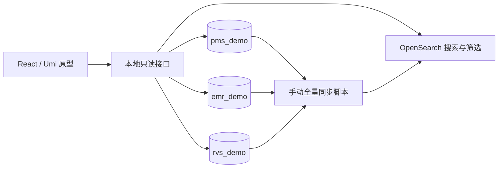

# OIS 原型设计说明

## 原型组成

OIS 的 Portal 使用 React/Umi，业务子应用使用 Angular，后端为 C#、PostgreSQL，当前通过 qiankun 集成。原型在独立的 React/Umi 应用内提供搜索、筛选和详情，以三个真实的 PostgreSQL 原型库及 OpenSearch 验证数据链路。

需求和规则见 [需求说明](requirements.md)，完整字段及约束见 [表结构与索引](data-model.md)，页面与跳转见 [交互流程](interaction-flows.md)。验收映射统一放在 [测试用例](test-cases.md)。

## 设计目标

- 全局搜索与临床条件筛选共用患者身份及业务关联，各自使用适合的查询结构。
- 每个命中结果保留来源对象标识，打开最新详情，支持沿诊断、申请单、计划追溯。
- 用可重复的虚构数据验证正例、反例及源数据变化，并支持完整重建搜索索引。

## 设计方案

### 独立运行的轻量原型

后续实现使用独立仓库根目录，包含 `web/`、`server/`、`scripts/`、`fixtures/`。当前只交付文档，目录结构为后续实现约定。

本地接口采用 Node.js/TypeScript，承担查询参数校验、OpenSearch 查询及结果整理、三库详情读取和关联检查。浏览器通过 Umi 开发代理调用它，数据库连接信息留在服务端。手动同步仍是命令行脚本，不增加调度或消息服务。与只有 JSON 样本的方案相比，这个接口用于支撑实际数据库的详情读取。

原型使用自己的配置文件及本地端口；调用链直接到原型接口，绕过 Ocelot。原型独立运行；现有 OIS 子应用接入时，由 Portal 适配导航目标。原型内跳转目标使用 `source / recordType / recordId / patientId / field`，以后接真实 Portal 时可由导航适配层转换。

### 五张业务表与完整关联

`pms_demo.patients` 保存患者，`emr_demo` 保存 `diagnoses`、`plan_requests`、`documents`，`rvs_demo.treatment_plans` 保存计划。共同使用患者 UUID，其他对象各有独立 UUID。EMR 内用外键和患者一致性约束；跨库引用在写入样例、同步和读取详情时校验。

跨库查询由本地接口分别读取后按 UUID 组合，不在单个 PostgreSQL 连接里把三个数据库当作 schema 联表。原型通过完整手动同步建立检索投影，详情始终回到对应业务库。

### 分别建立记录索引和患者索引

- 记录索引：一条业务对象对应一个文档，供全文搜索、分类计数、片段高亮使用。ID 包含来源、类型和对象 UUID，计划申请单不重复写成其他单据。
- 患者索引：一个患者对应一个文档，保存患者属性，以及按具体诊断组织的结构化条件和关联计划。患者命中数量天然对应患者数。

患者索引中的诊断使用 `nested` 对象。诊断名称、确认状态、日期及其计划关系必须在同一个诊断对象内匹配，避免多个诊断的字段互相拼接。选择 `nested` 是因为普通对象数组会展平字段，不能保证组合条件来自同一个数组成员。[OpenSearch nested 官方说明](https://docs.opensearch.org/latest/mappings/supported-field-types/nested/)

诊断选项使用样例中明确维护的规范名称；前端可输入名称或编码查找选项，并明确区分“按名称”和“按编码”两种选项。提交 `matchMode` 与选中值，临床条件不从自由正文推断。

按名称选择时，精确匹配 `diagnosisName.keyword`，记录是否保存编码不影响名称匹配。按编码选择时，同时精确匹配 `codeSystem / codeVersion / code`；缺少编码的记录不满足该编码条件。中文分词用于全局搜索和查找选项，不扩大已选临床诊断的范围。样例使用统一规范名称，不依靠词义相似度补齐诊断。

筛选结果的匹配依据从本次查询使用的索引批次产生；完整详情从数据库读取。这样可以分别解释“为何被这一批查询命中”和“现在的记录是什么”。

### 临床条件的查询顺序

先按范围、性别和年龄过滤患者。对每位患者，令 `D` 为同时满足已选诊断、确认状态和诊断日期的可用诊断集合；未选择诊断条件时，`D` 为该患者全部可用诊断。

- 设置了任一诊断条件时，增加 `D` 非空的约束。
- 计划为“有”时，要求 `D` 中存在 `hasRelatedPlan = true` 的诊断。
- 计划为“无”时，排除 `D` 中存在 `hasRelatedPlan = true` 的患者。在患者层使用 `must_not nested(...)`，不能用“存在一条无计划诊断”替代。
- 计划为“不限”时，不增加计划约束。

`D` 中全部诊断作为匹配依据可查看；选择“有”时额外标明哪些诊断提供了计划依据。患者已进入结果后，不能因为默认 `inner_hits` 数量限制而丢失剩余依据。申请单和计划的显示名称从同一批次的记录索引按 UUID 补齐，不用实时详情改写本次查询依据。

本次查询固定 `referenceDate` 为 Asia/Shanghai 当天日期，并在翻页及返回时保留。年龄按出生年月日比较计算周岁，在查询时换算为出生日期范围，不把固定年龄写进索引。范围、条件、计算日期和 `batchId` 一起构成查询状态。

### 完整手动同步与失败恢复

同步脚本以单进程运行。测试操作顺序为“修改源库 → 停止样例写入 → 同步 → 检查结果”；三个数据库的读取不宣称是一个跨库事务快照。

1. 读取三库并检查所有必需引用、患者一致性及源字段格式。
2. 根据同一份读取结果构建记录、患者两份投影，写入带同一批次标识的新索引。
3. 检查每条批量写入结果、文档数量、关联摘要及必要查询，完成刷新后才发布。
4. 用同一次 `_aliases` 请求切换两组查询别名。该 API 支持把多次别名操作作为一个原子操作执行。[官方别名接口](https://docs.opensearch.org/latest/api-reference/alias/aliases-api/)
5. 记录批次、三库读取时间、完成时间和对象数量；发布前失败时保留旧索引及错误明细。发布结果不明时先核对活动别名，不能直接断言切换失败。

同步元数据保存为原型目录中的本地 JSON 清单；它记录运行结果，不充当业务数据库。活动批次以两个查询别名实际指向的一致批次为准；清单写入失败后回查别名并修复状态，不误报为仍使用旧批。首次没有成功批次时接口返回“尚未同步”。发布前更新失败但有旧批次时，界面说明正在使用上次完整数据。健康批次内没有计划才可表达为“无关联计划”。

删除、作废、患者资料更正、诊断状态修改或关联变化均在下一次成功同步时反映。全量构建避免只新增不清理的残留文档，也使关联患者信息和计划存在性一起更新。

### 查询与详情接口

| 接口 | 输入及用途 | 主要输出 |
|---|---|---|
| `GET /api/prototype/search` | `q`、患者范围及患者 UUID、来源、类型、分页、批次 | 独立记录结果、准确记录总数、类型计数、命中字段、片段、批次 |
| `POST /api/prototype/clinical-filter` | 患者范围及患者 UUID、诊断选中值、确认状态、诊断起止日期、年龄上下限、性别、有无计划、分页、批次和计算日期 | 患者列表、准确患者总数、匹配诊断及关联摘要、计算日期、批次 |
| `GET /api/prototype/diagnosis-options` | 名称或编码输入、批次 | 可选择的规范诊断名称与编码体系信息 |
| `GET /api/prototype/patients/:id` | 患者 UUID | 最新患者资料与分组关联记录 |
| `GET /api/prototype/records/:source/:type/:id` | 原始对象定位信息 | 最新记录、所属患者及明确关联；必要时返回已删除、已作废或关系异常 |
| `GET /api/prototype/index-status` | 无 | 当前批次、上次成功时间、最近同步结果 |

接口只接受已列出的条件和定位参数，服务端构建查询；来源及对象类型使用白名单，数据库读取使用参数绑定。片段返回可安全渲染的文本和高亮区间，不执行来自单据正文的 HTML。

新查询由服务端确定当前完整批次及年龄计算日期；分页和状态恢复使用服务端返回的值，不能任意指定其他索引。列表和分类计数排除 OpenSearch 部分失败、超时或不精确总数的成功路径。首次未同步、查询失败、旧批次已不可用分别返回可识别状态，前端据此提示，不使用空数组掩盖失败。

分页每页 20 条，保留稳定的最终排序键。全局搜索先排序精确编号匹配，再按标题/姓名和正文相关性排序，同分按来源更新时间、对象 ID 固定顺序。临床筛选按放疗号及患者 UUID 固定顺序。检索采用固定的成功索引批次；跨页不混合两批数据，批次变化时提示重新查询。

### 详情和返回状态

页面的查询状态包括模式、关键词、条件、范围、来源、分类、页码、滚动位置和索引批次。诊断、申请单及计划以原始 UUID 跳转；关联不存在时显示明确提示，不按名称替换目标。

返回已有结果时恢复该次查询状态；源记录更新或索引批次改变时显示刷新提示。最新详情显示记录实际状态，匹配依据仍标明其所属批次。点击只打开记录，不修改任何业务状态。

## 风险与处理

- **全文提及被当作确诊** → 两种入口分别执行全文匹配和结构化筛选，结果保留明确的命中依据。
- **跨诊断拼接条件** → 以具体诊断为关联起点，患者索引使用嵌套诊断，并准备另一诊断有计划的反例。
- **三库更新时点不同** → 原型在停止样例写入后同步，记录读取时间并校验引用；详情读取仍可能更新，界面提示差异。
- **手动同步有延迟** → 显示最近成功同步时间和批次；失败不发布部分数据。
- **未知值和缺失来源被当作否定** → 未知字段只有在相关条件不限时才不影响判断；来源失败单独报错。
- **两种索引增加存储与构建成本** → 二者由同一次全量读取生成，以减少查询时的跨来源组合；性能在实际原型上记录，不承诺未经测量的延迟。

## 本地运行与回滚

后续实现完成后，在独立本地配置中连接 `pms_demo`、`emr_demo`、`rvs_demo` 和原型专用 OpenSearch 索引，导入固定 UUID 的虚构样例，首次同步成功后启动页面。数据库账号和原型索引使用明确命名，初始化脚本在执行前校验目标名。

回滚页面时停止原型进程；回滚索引时把两组别名一起切回上一批完整索引。旧批次保留到新批次验收完成，清理只匹配原型明确创建的资源。原型数据重置只操作三个原型库，不能复用现有叫号库连接。
