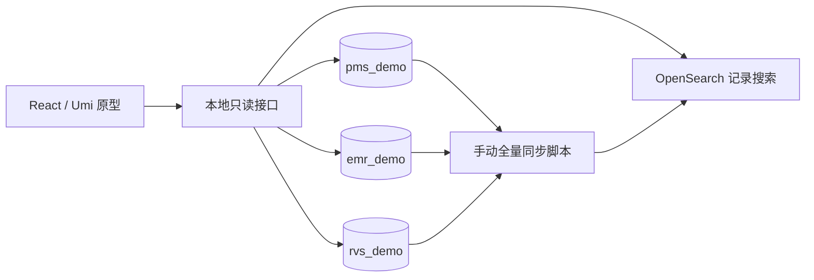

# OIS 全局搜索原型设计说明

## 原型组成

OIS 的 Portal 使用 React/Umi，业务子应用使用 Angular，后端为 C#、PostgreSQL，当前通过 qiankun 集成。原型在独立的 React/Umi 应用内提供全局搜索和详情，以三个真实的 PostgreSQL 原型库及 OpenSearch 验证数据链路。

需求和规则见 [需求说明](requirements.md)，完整字段及约束见 [表结构与索引](data-model.md)，页面与跳转见 [交互流程](interaction-flows.md)。验收映射统一放在 [测试用例](test-cases.md)。

## 设计目标

- 五类对象使用统一患者身份、搜索字段与结果格式，在一个入口检索跨来源记录。
- 每个命中结果保留来源对象标识，打开最新详情，支持沿诊断、申请单、计划追溯。
- 用可重复的虚构数据验证正例、反例及源数据变化，并支持完整重建搜索索引。

## 设计方案

### 独立运行的轻量原型

原型在独立仓库运行，`web/` 提供 React/Umi 页面，`server/` 提供本地接口，`scripts/` 提供建库、样例导入和同步命令，`fixtures/` 保存固定样例。

本地接口采用 Node.js/TypeScript，承担查询参数校验、OpenSearch 查询及结果整理、三库详情读取和关联检查。浏览器通过 Umi 开发代理调用它，数据库连接信息留在服务端。手动同步仍是命令行脚本，不增加调度或消息服务。与只有 JSON 样本的方案相比，这个接口用于支撑实际数据库的详情读取。

原型使用自己的配置文件及本地端口；调用链直接到原型接口，绕过 Ocelot。原型独立运行；现有 OIS 子应用接入时，由 Portal 适配导航目标。原型内跳转目标使用 `source / recordType / recordId / patientId / field`，以后接真实 Portal 时可由导航适配层转换。

### 五张业务表与完整关联

`pms_demo.patients` 保存患者，`emr_demo` 保存 `diagnoses`、`plan_requests`、`documents`，`rvs_demo.treatment_plans` 保存计划。共同使用患者 UUID，其他对象各有独立 UUID。EMR 内用外键和患者一致性约束；跨库引用在写入样例、同步和读取详情时校验。

跨库查询由本地接口分别读取后按 UUID 组合，不在单个 PostgreSQL 连接里把三个数据库当作 schema 联表。原型通过完整手动同步建立检索投影，详情始终回到对应业务库。

### 一套记录搜索索引

每个患者或业务记录对应一条搜索文档，包含来源、对象类型、对象 UUID、患者身份、标题、正文、状态、时间和关联标识。文档 ID 包含来源、类型和对象 UUID，计划申请单不重复写成其他单据。共用映射和返回结构让五类记录使用同一套全文查询、分类计数、片段高亮和分页逻辑。

记录索引名为 `ois-records-<batchId>`，查询别名为 `ois-records`。患者本身也作为 `patient` 类型记录参与这一索引。诊断、申请单和计划的关系用于打开详情，不把关联对象的全文拼接到当前记录正文。

文本字段以 CJK 分析器建立检索基线。姓名、标题、单据类型和正文另建单字子字段，供单个汉字查询及高亮。编号及编码保持精确匹配。用户可限定全部患者或当前患者、来源和对象类型。确认状态、计划状态、性别及日期按源数据展示，缺失值明确标记。搜索“鼻咽癌”可命中疑似、已排除或家族史正文，展示时保留原文上下文。

搜索结果、命中字段和片段从本次查询的成功索引批次产生；完整详情及关联列表从数据库读取。这样可以分别解释“当时命中了什么”和“现在的记录是什么”。

### 完整手动同步与失败恢复

同步脚本以单进程运行。测试操作顺序为“修改源库 → 停止样例写入 → 同步 → 检查结果”；三个数据库的读取不宣称是一个跨库事务快照。

1. 读取三库并检查所有必需引用、患者一致性及源字段格式。
2. 根据本次读取结果构建记录投影，写入带批次标识的新记录索引。
3. 检查每条批量写入结果、记录总数、各类型数量、关联标识及必要查询，完成刷新后才发布。
4. 用同一次 `_aliases` 请求移除 `ois-records` 的旧指向并添加新指向。该 API 支持把多次别名操作作为一个原子操作执行。[官方别名接口](https://docs.opensearch.org/latest/api-reference/alias/aliases-api/)
5. 记录批次、三库读取时间、完成时间和对象数量；发布前失败时保留旧索引及错误明细。发布结果不明时先核对活动别名，不能直接断言切换失败。

同步元数据保存为原型目录中的本地 JSON 清单；它记录运行结果，不充当业务数据库。活动批次以 `ois-records` 查询别名实际指向的批次为准；清单写入失败后回查别名并修复状态，不误报为仍使用旧批。首次没有成功批次时接口返回“尚未同步”。发布前更新失败但有旧批次时，界面说明正在使用上次完整数据。来源读取失败不会被转换成该来源零条记录。

删除、作废、患者资料更正、诊断状态修改或关联变化均在下一次成功同步时反映。全量构建避免只新增不清理的残留文档，同时更新各记录中复制的患者资料与关联标识。

### 查询与详情接口

| 接口 | 输入及用途 | 主要输出 |
|---|---|---|
| `GET /api/prototype/search` | `q`、患者范围及患者 UUID、来源、类型、分页、批次 | 独立记录结果、准确记录总数、类型计数、命中字段、片段、批次 |
| `GET /api/prototype/patients/:id` | 患者 UUID | 最新患者资料与分组关联记录 |
| `GET /api/prototype/records/:source/:type/:id` | 原始对象定位信息 | 最新记录、所属患者及明确关联；必要时返回已删除、已作废或关系异常 |
| `GET /api/prototype/index-status` | 无 | 当前批次、上次成功时间、最近同步结果 |

接口只接受关键词、患者范围、来源、对象类型、分页及定位参数，服务端构建查询；来源及对象类型使用白名单，数据库读取使用参数绑定。片段返回可安全渲染的文本和高亮区间，不执行来自单据正文的 HTML。

新查询由服务端确定当前完整批次；分页和状态恢复使用服务端返回的值，不能任意指定其他索引。列表和分类计数排除 OpenSearch 部分失败、超时或不精确总数的成功路径。首次未同步、查询失败、旧批次已不可用分别返回可识别状态，前端据此提示，不使用空数组掩盖失败。

分页每页 20 条，保留稳定的最终排序键。全局搜索先排序精确编号匹配，再按标题/姓名和正文相关性排序，同分按来源更新时间、对象 ID 固定顺序。检索采用固定的成功索引批次；跨页不混合两批数据，批次变化时提示重新查询。

### 详情和返回状态

页面的查询状态包括关键词、患者范围、来源、分类、页码、滚动位置和索引批次。诊断、申请单及计划以原始 UUID 跳转；关联不存在时显示明确提示，不按名称替换目标。

返回已有结果时恢复该次查询状态；源记录更新或索引批次改变时显示刷新提示。最新详情显示记录实际状态，搜索时的命中内容仍标明其所属批次。点击只打开记录，不修改任何业务状态。

## 风险与处理

- **正文提及被当作确诊** → 搜索结果展示原文上下文及来源实际保存的状态，不由关键词推断诊断。
- **同名或相似记录被误开** → 使用来源、对象类型和 UUID 定位，准备同名患者及同患者多条记录的样例。
- **三库更新时点不同** → 原型在停止样例写入后同步，记录读取时间并校验引用；详情读取仍可能更新，界面提示差异。
- **手动同步有延迟** → 显示最近成功同步时间和批次；失败不发布部分数据。
- **来源失败被当作无结果** → 来源读取、查询、详情错误分别报错，保留上一批完整搜索数据。
- **搜索副本增加存储与构建成本** → 使用单一记录索引完成首版检索，按实际样例规模记录耗时，不承诺未经测量的性能。

## 本地运行与回滚

按 [启动说明](../README.md#本地启动) 使用独立本地配置连接 `pms_demo`、`emr_demo`、`rvs_demo` 和原型专用 OpenSearch 索引，导入固定 UUID 的虚构样例，首次同步成功后启动页面。数据库账号和原型索引使用明确命名，初始化脚本在执行前校验目标名。

回滚页面时停止原型进程；回滚索引时把记录查询别名切回上一批完整索引。旧批次保留到新批次验收完成，清理只匹配原型明确创建的资源。原型数据重置只操作三个原型库，不能复用现有叫号库连接。

「按诊断找患者」使用同一发布批次的诊断文档。演示字典将诊断名称映射为体系、版本和编码，缺编码的诊断按完整名称匹配。现有样例中标为疑似的记录不参与患者筛选。搜索结果按患者 ID 合并，以最新匹配诊断为代表，当页患者姓名和放疗号从 PMS 批量读取。
