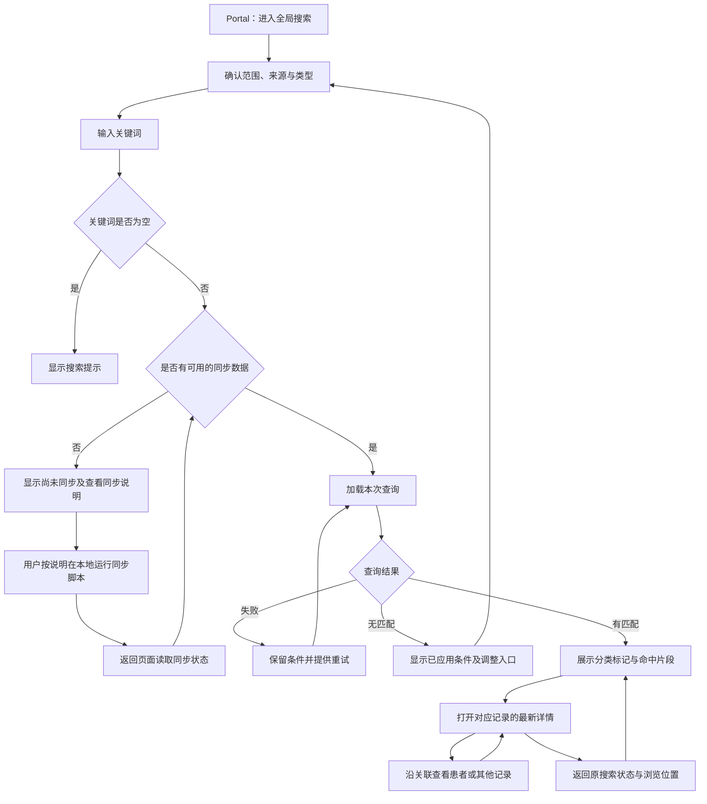
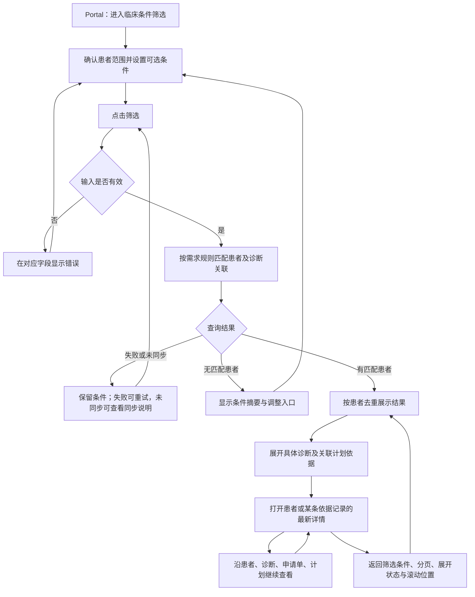

# OIS 搜索原型交互流程

工作人员在 Portal 中选择全局搜索或临床条件筛选，找到记录或患者，再进入原型详情查看来源和关联。业务匹配规则以[需求说明](requirements.md)为准，对象字段及关系见[数据设计](data-model.md)。

## 入口与搜索范围

Portal 头部固定显示“演示数据”，并提供“全局搜索”和“临床条件筛选”两个入口。两种模式分别保存输入、条件和结果；切换模式时恢复该模式上次的状态。关键词不会自动转成临床筛选条件。

搜索范围始终显示在输入区上方：

| 范围 | 显示与操作 |
| --- | --- |
| 全局 | 显示“全部患者”，搜索可用样例数据。首次进入使用此范围。 |
| 当前患者 | 显示“当前患者：姓名 · 放疗号”，只查询该患者及其关联记录；可一键切回全局。 |

患者或记录详情提供“在此患者范围搜索”入口。用户点击后，搜索区明确切换到该患者；仅浏览详情不会暗中改变搜索范围。没有患者上下文时，当前患者选项不可选。两种模式都在提交条件前显示实际范围。

原型内的患者、诊断、申请单、计划和其他单据详情由 React/Umi 页面展示，分别读取对应原型数据源的最新内容。

## 全局搜索

### 输入与分类

用户可输入姓名、放疗号、记录编号、标题或正文关键词。输入停止 300 毫秒后搜索，按 Enter 立即搜索。清空输入后回到搜索起始状态。

来源选项为“全部、PMS、EMR、RVS”；类型选项为“全部、患者、诊断、计划申请单、治疗计划、其他单据”。选定来源后，只显示该来源支持的类型；若原类型不再适用，类型控件明确回到“全部”。关键词、范围、来源或类型改变后，从第一页展示新结果。每页固定展示 20 条记录。

结果上方显示已应用的关键词、范围、来源、类型和记录总数。类型计数按本次关键词、患者范围和来源条件计算，总数按当前类型计算。完整编号的精确匹配优先，放疗号保留前导零；每条记录都有类型与来源标记。正在输入的新关键词与当前已返回结果的条件分别显示，避免把旧结果误认成新结果。

```text
Portal · 演示数据               [全局搜索] [临床条件筛选]
范围：[全部患者 ▾]        最近同步：11月8日 10:00 [同步说明]

[姓名、放疗号、记录编号或内容关键词                 ][搜索]
来源：[全部] [PMS] [EMR] [RVS]
类型：[全部] [患者] [诊断] [计划申请单] [治疗计划] [其他单据]

关键词：鼻咽癌 · 全部患者                      共 12 条记录
┌─────────────────────────────────────────────────────┐
│ [诊断] [EMR] 鼻咽癌                         [查看详情] │
│ 林示例 · 放疗号 RT000123 · 确诊 · 2026-10-20         │
│ 命中字段：诊断名称；匹配文字以高亮显示                 │
├─────────────────────────────────────────────────────┤
│ [计划申请单] [EMR] 鼻咽癌放疗计划申请        [查看详情] │
│ 林示例 · RT000123 · 申请单号 REQ-001 · 2026-10-21     │
│ 命中字段：申请内容；展示包含关键词的完整语境           │
└─────────────────────────────────────────────────────┘
                              [上一页] 1 / 1 [下一页]
```

### 结果内容与去向

| 类型 | 卡片主要内容 | 点击标题或“查看详情” |
| --- | --- | --- |
| 患者 | 姓名、放疗号、性别、出生日期或未知提示、PMS 来源、命中字段 | 打开该患者详情，查看患者资料及关联记录。 |
| 诊断 | 规范诊断名称、编码、确认状态、诊断日期、患者姓名与放疗号、EMR 来源 | 打开该条诊断详情，查看来源及该诊断下的申请单和计划。 |
| 计划申请单 | 申请单名称与编号、申请日期、关联诊断、患者身份、EMR 来源、命中片段 | 打开该申请单详情，查看具体诊断及对应 RVS 计划。 |
| 治疗计划 | 计划名称与编号、计划状态、计划日期、来源申请单、患者身份、RVS 来源、命中片段 | 打开该计划详情，追溯来源申请单和具体诊断。 |
| 其他单据 | 单据类型、标题、单据日期、患者身份、EMR 来源、命中片段 | 打开该单据详情，并定位命中字段或正文。 |

结果按对象分别展示；同一患者的多份单据、申请单和计划保留各自身份。计划申请单只出现在其自身类型中。卡片上的患者姓名提供独立的“查看患者”链接，其目标与记录标题不同。

命中片段显示字段名和关键词周围的文字。确认状态使用结构化数据单独标记，正文命中只说明出现了相关文字。进入详情后，仍然存在的命中内容会被定位和高亮。



## 临床条件筛选

### 条件区

临床条件由用户逐项选择，点击“筛选”后提交。所有条件均可选；不设置条件时点击“筛选”，展示当前范围内全部可用样例患者。修改条件后，按钮旁显示“条件已修改，点击筛选”；结果摘要继续显示上次实际应用的条件。

| 条件 | 控件与反馈 |
| --- | --- |
| 诊断 | 可搜索的单选控件，选项明确标示“按规范名称”或“按编码”；编码选项同时显示体系和版本。清除后表示不限诊断。输入文字用于查找选项，选中后才成为筛选条件。 |
| 确认状态 | 单选“不限、确诊、疑似、已排除、未知”，默认不限。 |
| 诊断日期 | 起始日期与结束日期，可分别清除；字段说明明确其作用于诊断日期。 |
| 年龄 | 最小与最大年龄输入框，单位为岁，可分别清除；输入区按需求说明展示计算口径及本次筛选的计算基准日期。 |
| 性别 | 单选控件，选项使用数据设计中的取值，并提供“不限”和“未知”。 |
| 是否有关联计划 | 单选“不限、有、无”，默认不限；控件下展示需求说明规定的关联判断口径。 |

年龄计算、未知值、诊断条件组合及“无关联计划”的判定统一引用[需求说明](requirements.md)。申请单与计划是否满足条件，沿具体诊断的关联判断；界面展开相应依据，避免把同一患者其他诊断的计划混入。

日期起点晚于终点、年龄下限大于上限或年龄输入无效时，在对应字段下提示并阻止提交。清空条件后恢复各项“不限”；用户再次点击“筛选”时更新结果。每页固定展示 20 名患者。

```text
Portal · 演示数据               [全局搜索] [临床条件筛选]
范围：[全部患者 ▾]        最近同步：11月8日 10:00 [同步说明]

诊断：[鼻咽癌（规范名称与编码） ▾]   确认状态：[确诊 ▾]
诊断日期：[开始日期] 至 [结束日期]
年龄：[最小岁数] 至 [最大岁数]      性别：[不限 ▾]
是否有关联计划：[有 ▾]             [清空条件] [筛选]
年龄计算基准：2026-11-08；关联计划说明显示在对应控件下方

已应用：鼻咽癌 · 确诊 · 有关联计划                 共 3 名患者
┌──────────────────────────────────────────────────────┐
│ 林示例 · RT000123 · 性别 / 年龄            [查看患者]   │
│ [展开匹配依据]                                        │
│   诊断：鼻咽癌 · 确诊 · 2026-10-20       [查看诊断]    │
│     申请单 REQ-001 → 计划 PLAN-001       [查看关联]    │
└──────────────────────────────────────────────────────┘
                              [上一页] 1 / 1 [下一页]
```

### 患者结果与匹配依据

结果按患者 UUID 汇总，每名患者只展示一行；同名患者通过放疗号区分。总数和分页均以患者为单位。

每行显示姓名、放疗号、性别、计算年龄及其基准日期，提供“查看患者”和“展开匹配依据”。展开内容按具体诊断组织，显示匹配的规范名称与编码、确认状态、诊断日期，以及该诊断下与筛选有关的申请单、计划。多条诊断满足条件时逐条列出，不另增患者行。

年龄、性别等患者条件的依据显示在患者资料区。未设置诊断相关条件时，依据区按需求说明展示实际参与判断的信息；空条件结果注明“当前未设置筛选条件”。“无关联计划”的依据文案沿用需求说明的判定口径。

点击“查看患者”后，详情展开匹配依据对应的诊断及关联记录；点击某条诊断、申请单或计划名称，直接打开该条记录。记录关联只沿数据设计中保存的关系展示。



## 详情与关联跳转

详情头部显示对象类型、来源、标题或编号、所属患者及来源更新时间。正文按对象字段分区，关联区提供以下入口：

| 当前详情 | 关联入口 |
| --- | --- |
| 患者 | 该患者的诊断、计划申请单、治疗计划和其他单据。 |
| 诊断 | 所属患者、已关联的来源单据、该诊断下的申请单及其治疗计划。 |
| 计划申请单 | 所属患者、该申请单对应的具体诊断、以该申请单为来源的治疗计划。 |
| 治疗计划 | 所属患者、唯一来源申请单、经该申请单关联的具体诊断。 |
| 其他单据 | 所属患者及数据模型中明确关联的诊断。 |

每个关联入口显示目标类型、名称及该对象已有的编号；患者身份始终可见。申请单与计划分别有独立详情。关联目标被删除、已作废、不可读取或关系不一致时，显示具体原因并保留当前详情，不跳到其他患者或同名记录。

详情提供“返回上一页”和“返回搜索结果”。前者回到上一个详情或列表；后者直接恢复发起本次查看的搜索模式、范围、关键词或已应用条件、来源与类型、页码、展开项和滚动位置。连续关联跳转仍保留原结果入口。

## 查询与同步状态

Portal 始终显示最近一次成功同步时间，并提供“同步说明”。说明展示原型同步脚本的本地执行方法；用户在命令行运行脚本后，回到页面读取同步状态。页面只查看同步结果，查询继续使用上一批完整可用数据。首次同步完成前显示“尚未同步”。

页面读取到新的成功同步批次后，已经打开的结果保持原状，出现“数据已更新，刷新结果查看”的提示。点击“刷新结果”沿用已应用条件，从第一页加载并回到列表顶部；同一次查询的分页使用同一批次数据。

| 状态 | 界面表现与操作 |
| --- | --- |
| 全局搜索起始状态 | 显示可输入的字段示例，等待关键词。 |
| 临床筛选起始状态 | 显示可选条件和“筛选”按钮；空条件提交可查看全部可用样例患者。 |
| 加载中 | 显示加载提示。保留输入和已应用条件；后返回的旧请求不能覆盖新条件的结果。 |
| 无结果 | 显示本次实际应用的范围和条件，提供调整或清除入口。全局模式显示“未找到匹配记录”，筛选模式显示“未找到匹配患者”。 |
| 查询失败 | 明确显示失败并提供“重试”，保留条件；若展示上次成功结果，同时标记其条件和时间。 |
| 尚未同步 | 显示“尚未同步搜索数据”和“查看同步说明”，保留已输入条件。 |
| 回源对比发现内容变化 | 展示最新详情和最近同步时间，提示“详情与搜索时不同，可能需要重新同步”，提供“查看同步说明”。 |
| 最近一次同步失败 | 显示同步结果中的失败原因和“查看同步说明”，上一批完整数据继续可用。没有成功数据时保持尚未同步状态。 |
| 同步成功、原结果尚未刷新 | 显示“数据已更新，刷新结果查看”，刷新前保留原结果与条件。 |
| 详情读取失败 | 显示“详情加载失败”和“重试”，保留返回结果入口；搜索片段仍属于上次搜索内容。 |
| 记录已删除 | 显示“该记录已删除”，提供返回结果和刷新结果入口。 |
| 记录已作废 | 显示“该记录已作废”，提供返回结果和刷新结果入口。 |

## 最新详情与搜索结果差异

搜索列表和临床筛选结果基于最近一次完整同步的数据，详情读取来源库的最新内容。只有回源对比发现差异后，详情顶部才显示“内容已更新，当前详情与搜索时不同”，同时展示来源更新时间和搜索数据同步时间，并提供“查看同步说明”。最近成功同步时间持续可见，来源尚未读取时不显示已检测到变更的提示。

对于全局搜索，最新正文中仍存在的关键词继续高亮；原命中内容已被修改时，说明原命中片段已变化。对于临床筛选，原匹配依据标为“搜索时的匹配依据”，最新详情与旧依据分别标识；若当前搜索数据仍是旧批次，提示先查看同步说明，再重新查询。

用户按说明在本地运行同步脚本，成功后刷新结果。刷新完成后，已删除或已作废的记录、已变化的诊断确认状态和已调整的关联按需求说明重新参与搜索或筛选，结果数量随之更新。
