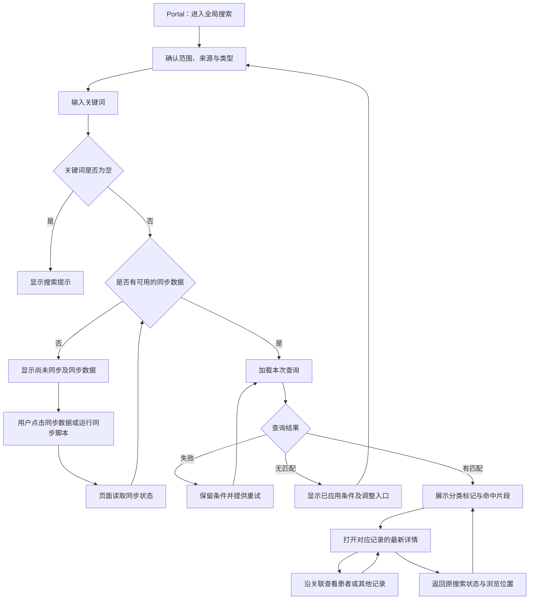

# OIS 全局搜索原型交互流程

工作人员在 Portal 中通过全局搜索找到患者或业务记录，再进入原型详情查看来源和关联。搜索规则以[需求说明](requirements.md)为准，对象字段及关系见[数据设计](data-model.md)。

## 入口与搜索范围

Portal 头部固定显示“演示数据”，并提供“全局搜索”入口。搜索页保留关键词、范围、来源、类型和结果状态，便于查看详情后继续查找。

搜索范围始终显示在输入区上方：

| 范围 | 显示与操作 |
| --- | --- |
| 全局 | 显示“全部患者”，搜索可用样例数据。首次进入使用此范围。 |
| 当前患者 | 显示“当前患者：姓名 · 放疗号”，只查询该患者及其关联记录；可一键切回全局。 |

患者或记录详情提供“在此患者范围搜索”入口。用户点击后，搜索区明确切换到该患者；仅浏览详情不会暗中改变搜索范围。没有患者上下文时，当前患者选项不可选。搜索前始终显示实际范围。

React/Umi 页面经本地 Node 接口查询 OpenSearch 的单一 records 索引。患者、诊断、申请单、计划和其他单据分别作为记录展示；详情通过同一本地接口读取 PMS、EMR、RVS 三个原型数据库的最新内容。

## 全局搜索

### 输入与分类

用户可输入姓名、放疗号、记录编号、诊断编码、单据类型、标题或正文关键词。输入停止 300 毫秒后搜索，按 Enter 立即搜索。清空输入后回到搜索起始状态。

来源选项为“全部、PMS、EMR”。记录分类为全部记录、患者、诊断，以及定位申请单、复位申请单、计划申请单、后装申请单、一站式申请单、检查预约单、全身放疗申请单、治疗单、自定义单据。全部记录是这些分类的合计。已中止不是单独分类。选定来源后，只显示该来源支持的分类；若原分类不再适用，分类控件明确回到“全部”。关键词、范围、来源或类型改变后，从第一页展示新结果。每页固定展示 20 条记录。

结果上方显示已应用的关键词、范围、来源、类型和记录总数。类型计数按本次关键词、患者范围和来源条件计算，总数按当前类型计算。完整编号的精确匹配优先，放疗号保留前导零；每条记录都有类型与来源标记。正在输入的新关键词与当前已返回结果的条件分别显示，避免把旧结果误认成新结果。

```text
Portal · 演示数据                              [全局搜索]
范围：[全部患者 ▾]        最近同步：11月8日 10:00 [同步说明]

[姓名、放疗号、记录编号或内容关键词                 ][搜索]
来源：[全部] [PMS] [EMR]
类型：[全部记录] [患者] [诊断] [定位申请单] [复位申请单] [计划申请单] [后装申请单] [一站式申请单] [检查预约单] [全身放疗申请单] [治疗单] [自定义单据]

关键词：鼻咽癌 · 全部患者                       共 7 条记录
┌─────────────────────────────────────────────────────┐
│ [诊断] [EMR] 鼻咽癌                         [查看详情] │
│ 林示例 · 放疗号 000123 · 确诊 · 2026-10-01           │
│ 命中字段：诊断名称；匹配文字以高亮显示                 │
├─────────────────────────────────────────────────────┤
│ [计划申请单] [EMR] 鼻咽癌放疗申请            [查看详情] │
│ 林示例 · 000123 · 申请单号 REQ-001 · 2026-10-05       │
│ 命中字段：标题；匹配文字以高亮显示                     │
└─────────────────────────────────────────────────────┘
                              [上一页] 1 / 1 [下一页]
```

输入支持的确诊查询后，结果区显示已应用的诊断、日期范围及适用的编码范围。输入包含处方分次时，同时显示分次数下限。列表按患者展示。打开患者详情后，可沿关联记录查看原始诊断和计划申请单。

### 结果内容与去向

| 类型 | 卡片主要内容 | 点击标题或“查看详情” |
| --- | --- | --- |
| 患者 | 姓名、放疗号、性别、出生日期或未知提示、PMS 来源、命中字段 | 打开该患者详情，查看患者资料及关联记录。 |
| 诊断 | 规范诊断名称、编码、确认状态、诊断日期、患者姓名与放疗号、EMR 来源 | 打开该条诊断详情，查看来源及该诊断下的申请单和计划。 |
| 计划申请单 | 申请单名称与编号、申请日期、关联诊断、患者身份、EMR 来源、命中片段 | 打开该申请单详情，查看具体诊断及对应 RVS 计划。 |
| 治疗计划 | 计划名称与编号、计划状态、计划日期、来源申请单、患者身份、RVS 来源、命中片段 | 打开该计划详情，追溯来源申请单和具体诊断。 |
| 其他单据 | 单据类型、标题、单据日期、患者身份、EMR 来源、命中片段 | 打开该单据详情，并定位命中字段或正文。 |

结果按对象分别展示；同一患者的多份单据、申请单和计划保留各自身份。计划申请单只出现在其自身类型中。卡片上的患者姓名提供独立的“查看患者”链接，其目标与记录标题不同。

命中信息显示实际字段名、匹配值或关键词周围的文字。姓名、编号、编码和单据类型命中均展示对应依据；正文命中保留完整语境。诊断确认状态和计划状态按源记录单独展示，关键词匹配只说明字段或正文中出现了相关内容。进入详情后，仍然存在的命中内容会被定位和高亮。



## 详情与关联跳转

详情头部显示对象类型、来源、标题或编号、所属患者及来源更新时间。正文按对象字段分区，关联区提供以下入口：

| 当前详情 | 关联入口 |
| --- | --- |
| 患者 | 该患者的诊断、计划申请单、治疗计划和其他单据。 |
| 诊断 | 所属患者、已关联的来源单据、该诊断下的申请单及其治疗计划。 |
| 计划申请单 | 所属患者、该申请单对应的具体诊断、以该申请单为来源的治疗计划。 |
| 治疗计划 | 所属患者、唯一来源申请单、经该申请单关联的具体诊断。 |
| 其他单据 | 所属患者及数据模型中明确关联的诊断。 |

每个关联入口显示目标类型、名称及该对象已有的编号；患者身份始终可见。申请单与计划分别有独立详情。关联目标被删除、已作废、不可读取或关系不一致时，显示具体原因并保留当前详情，不跳到其他患者或同名记录。

详情提供“返回上一页”和“返回搜索结果”。前者回到上一个详情或列表；后者直接恢复发起本次查看的范围、关键词、来源、类型、页码、滚动位置和搜索批次。连续关联跳转仍保留原结果入口。查看记录和沿关联跳转不修改业务状态。

## 查询与同步状态

Portal 在打开时显示最近一次成功同步时间，并提供「同步数据」和「同步说明」。同步只有两种入口：点击「同步数据」，或在项目根目录执行 `npm run sync`。页面不反复读取同步状态。点击「同步数据」完成后更新同步时间；命令行同步不改变已经打开的页面。同步进行中不能再次点击。查询继续使用上一批完整可用数据。首次同步完成前显示“尚未同步”。

在页面上同步成功后，已经打开的结果保持原状，出现“数据已更新，刷新结果查看”的提示。点击“刷新结果”沿用已应用条件，从第一页加载并回到列表顶部；同一次查询的分页使用同一批次数据。

| 状态 | 界面表现与操作 |
| --- | --- |
| 全局搜索起始状态 | 显示可输入的字段示例，等待关键词。 |
| 加载中 | 显示加载提示。保留输入和已应用条件；后返回的旧请求不能覆盖新条件的结果。 |
| 无结果 | 显示“未找到匹配记录”及本次实际应用的关键词、范围、来源和类型，提供调整或清除入口。 |
| 查询失败 | 明确显示失败并提供“重试”，保留条件；若展示上次成功结果，同时标记其条件和时间。 |
| 尚未同步 | 显示“尚未同步搜索数据”、“同步数据”和“查看同步说明”，保留已输入条件。 |
| 回源对比发现内容变化 | 展示最新详情和最近同步时间，提示“详情与搜索时不同，可能需要重新同步”，提供“查看同步说明”。 |
| 最近一次同步失败 | 显示同步结果中的失败原因和“查看同步说明”，上一批完整数据继续可用。没有成功数据时保持尚未同步状态。 |
| 同步成功、原结果尚未刷新 | 显示“数据已更新，刷新结果查看”，刷新前保留原结果与条件。 |
| 原查询批次已不可用 | 提示重新查询，保留关键词、范围、来源和类型；使用新批次时从第一页开始。 |
| 详情读取失败 | 显示“详情加载失败”和“重试”，保留返回结果入口；搜索片段仍属于上次搜索内容。 |
| 记录已删除 | 显示“该记录已删除”，提供返回结果和刷新结果入口。 |
| 记录已作废 | 显示“该记录已作废”，提供返回结果和刷新结果入口。 |

## 最新详情与搜索结果差异

搜索列表基于最近一次完整同步的记录数据，详情读取来源库的最新内容。只有回源对比发现差异后，详情顶部才显示“内容已更新，当前详情与搜索时不同”，同时展示来源更新时间和搜索数据同步时间，并提供“查看同步说明”。最近成功同步时间持续可见，来源尚未读取时不显示已检测到变更的提示。

最新字段或正文中仍存在的关键词继续高亮；原命中内容已被修改时，说明原匹配值或片段已变化。搜索时的命中信息与当前详情分别标识；若需要更新可搜索内容，用户可查看同步说明后重新查询。

用户点击「同步数据」或按说明运行同步脚本，成功后刷新结果。刷新完成后，搜索结果按当前可用记录及最新字段更新；详情关联继续沿保存的患者、诊断、申请单和计划标识跳转。
