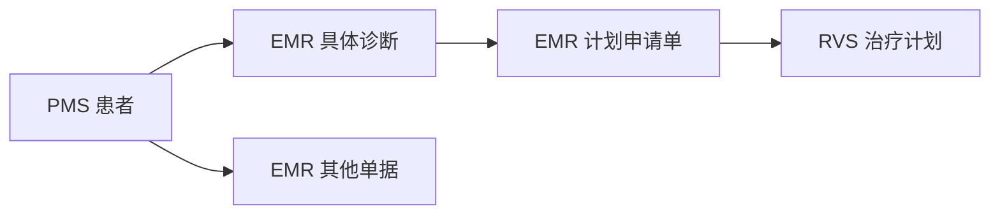

# OIS 搜索与临床条件筛选原型需求

工作人员通过一个入口搜索 PMS、EMR、RVS 的业务记录，或按明确的诊断及患者条件筛选患者，并打开原始记录查看依据。

## 数据与业务关联

原型使用三个实际的 PostgreSQL 数据库和虚构业务数据，页面明确标示“演示数据”。PMS 提供患者，EMR 提供诊断、计划申请单及其他单据，RVS 提供治疗计划。

每张计划申请单关联一条具体诊断，每份治疗计划关联一张申请单。链上记录必须属于同一患者。姓名可以重复；患者和各类记录使用独立标识识别，不能凭姓名或相似编号合并。

已删除、已作废的记录不参与新的搜索或筛选；失效的诊断或申请单不能继续支撑其下计划的临床匹配。其他仍有效的诊断、单据及关联保持独立。

## 全局搜索

### 搜索对象与结果

| 对象 | 可搜索内容 | 结果展示 | 点击去向 |
|---|---|---|---|
| 患者 | 姓名、放疗号 | 姓名、放疗号、性别、出生日期 | 原型内患者详情 |
| 诊断 | 规范诊断名称、已保存编码、诊断说明；患者姓名、放疗号 | 诊断名称、确认状态、诊断日期、所属患者、来源及命中内容 | EMR 诊断详情及关联申请单 |
| 计划申请单 | 申请单号、标题、申请内容；患者姓名、放疗号 | 标题、申请单号、申请日期、所属患者、关联诊断及命中内容 | EMR 申请单详情及关联计划 |
| 治疗计划 | 计划编号、名称、备注；患者姓名、放疗号 | 名称、编号、计划状态、所属患者、来源及命中内容 | RVS 计划详情及来源申请单 |
| 其他单据 | 单据类型、标题、正文；患者姓名、放疗号 | 标题、类型、单据日期、所属患者、来源及命中片段 | EMR 对应单据详情 |

计划申请单只作为“计划申请单”结果展示，不重复列入“其他单据”。同一患者的不同记录分别展示。

### 搜索范围与展示

- 顶部入口可在“全局搜索”和“临床条件筛选”之间切换，各自保留查询内容。
- 搜索范围明确显示“全部患者”或“当前患者：姓名／放疗号”。进入患者详情不会悄悄切换范围；没有选定患者时不能启用当前患者范围。
- 两种模式使用相同的患者范围定义；临床条件在当前范围内筛选，范围始终在提交条件前显示。
- 全局搜索支持按来源和对象类型筛选。结果数量按业务记录计算，分类计数与本次关键词、患者范围和来源条件一致。
- 完整编号的精确匹配优先；姓名、标题及正文命中提供相应上下文。放疗号保留前导零。
- 输入关键词后可自动查询，也可按 Enter 立即查询。空白输入显示搜索提示，未命中时显示无结果；搜索失败提供重试，不能显示成无结果。
- 正文提及可以被搜索命中，例如“疑似鼻咽癌”或“已排除鼻咽癌”；结果保留上下文，不能仅凭关键词把患者标记为确诊。

## 临床条件筛选

### 条件

| 条件 | 输入方式 | 作用对象与含义 |
|---|---|---|
| 诊断 | 输入名称或编码后选择明确标示匹配方式的诊断选项，或选择不限 | 按规范名称精确匹配，或按完整编码精确匹配；名称匹配不要求记录有编码 |
| 确认状态 | 不限、确诊、疑似、已排除、未知 | 仅匹配来源记录明确保存的状态；未知表示来源未明确标记 |
| 诊断日期 | 起止日期，可只填一端 | 作用于诊断日期，包含起止当天 |
| 年龄 | 周岁下限、上限，可只填一端 | 按本次筛选当天计算周岁，页面显示计算基准日期；上下限均包含 |
| 性别 | 不限或一个已保存的性别选项 | 作用于患者资料；未知与其他值分别展示 |
| 是否有关联计划 | 不限、有、无 | 依据符合诊断条件的记录，沿申请单查找有效计划 |

不同条件之间同时满足。诊断名称、确认状态和诊断日期必须由同一条诊断满足；不能把一条疑似鼻咽癌和另一条已确诊的不同诊断拼成“鼻咽癌确诊”。

未选的条件不限制结果；全部条件为空时，执行筛选可查看全部可用样例患者。只使用患者属性时，不要求患者必须存在诊断。使用诊断条件时，患者至少有一条诊断满足这些条件。

年龄上下限为非负整数；下限不得大于上限，诊断开始日期不得晚于结束日期。输入不合法时说明对应问题并保留填写内容。

年龄以本次提交筛选时的日期为基准，本地原型采用 Asia/Shanghai 日期；当年生日已到计入新的一岁。翻页和返回结果沿用该次查询的计算日期，再次执行筛选时使用当天日期。诊断日期范围只作用于诊断，不作用于申请单或计划日期。

### 关联计划与匹配依据

计划只能通过“具体诊断 → 申请单 → 计划”参与匹配。患者其他诊断下的计划不能满足当前诊断的计划条件。存在计划表示有关联计划记录，不据此判断患者已经开始或完成治疗。

先按已选的诊断、确认状态及诊断日期找出该患者的“匹配诊断”，再判断计划：

| 计划条件 | 患者满足条件的情况 |
|---|---|
| 不限 | 不限制匹配诊断下是否有计划 |
| 有 | 至少一条匹配诊断通过有效申请单关联到有效计划 |
| 无 | 所有匹配诊断都没有通过有效申请单关联到有效计划；既有计划又无计划的多诊断患者不满足 |

未选任何诊断相关条件时，匹配诊断指该患者所有可用诊断；此时没有诊断的患者也可满足“无关联计划”。已选诊断相关条件时，必须先存在匹配诊断，不能把未找到诊断当作满足“无关联计划”。有匹配诊断但尚无申请单，也属于该诊断无关联计划。

临床筛选按患者去重，总数是患者数。结果展示姓名、放疗号、性别、年龄及其计算日期，并列出匹配诊断的名称、确认状态、诊断日期和关联计划情况。多条诊断满足条件时保留全部匹配依据，可展开查看申请单和计划。

结果中的依据与执行查询时使用的数据保持一致。打开患者或记录后读取当前详情；如果数据已变化，说明变化并提供刷新结果入口。

### 缺失值

缺少出生日期、诊断日期或确认状态时，明确展示未知。未限制该字段时，缺失值不影响其他条件；限制年龄或日期时，缺失对应数据不能视为满足条件。确认状态选择“未知”时可以明确查找该类记录。

单据正文提及、家族史文字、疑似或已排除的诊断，不能代替结构化的确诊记录。诊断是否确诊与疾病目前是否活动是不同含义，结果使用“确诊记录”表达实际依据。

## 详情、跳转与返回

患者详情按诊断、申请单、计划和其他单据组织记录。诊断详情可打开对应申请单；申请单可打开具体诊断及关联计划；计划可打开来源申请单。所有跳转保留所属患者信息。

搜索结果点击后进入对应记录，并定位命中的字段或正文片段。临床筛选结果点击后进入患者详情，突出显示匹配诊断及其关联。全文已修改而无法定位原片段时，展示最新内容并提示。

返回结果时保留查询模式、关键词、范围、来源、类型、筛选条件、页码和浏览位置。打开或查看记录不改变业务状态。目标记录已删除、已作废、来源不可用或关联异常时，分别说明原因并允许返回；不能改为打开同名记录。

## 数据更新与异常

源库修改后，通过手动同步更新可查询内容。页面显示最近成功同步时间。新增、修改、删除、作废及关联变化在下一次完整同步成功后反映到搜索和筛选结果。

姓名或放疗号更正时，关联结果中的患者信息一起更新；诊断状态、申请单所属诊断、计划所属申请单变化时，相应筛选依据一起更新。

尚未完成首次同步时，显示“尚未同步数据”。同步失败时保留上次完整数据并显示失败提示和上次成功时间；有来源读取失败、引用错误或写入失败时，不把部分数据作为新的完整结果发布。数据库读取失败不能被解释为无关联计划。

查询失败、无匹配、尚未同步和旧批次数据分别提示。同步后已有查询保持原结果并提示刷新，重新查询后使用新数据。

## 验收结果

| 场景 | 预期结果 |
|---|---|
| 搜索放疗号 | 找到同一患者在不同来源的记录，来源和对象类型清楚 |
| 搜索正文关键词 | 展示真实命中片段，进入正确记录并定位 |
| 搜索同名患者 | 按独立身份和放疗号区分，不混合记录 |
| 筛选确诊鼻咽癌及对应计划 | 按具体诊断的关联链判断，展示可追溯依据 |
| 多条匹配诊断中一条有计划、一条无计划 | 满足“有”，不满足“无” |
| 按年龄查询后跨日期返回 | 原结果沿用原计算日期，再次筛选才更新计算日期 |
| 同一患者有多条匹配诊断 | 患者只出现一次，全部匹配依据可查看 |
| 缺少条件所需数据 | 明确显示未知，不默认满足条件 |
| 修改或移除业务记录后同步 | 搜索结果、患者数量和关联依据按新数据变化 |
| 打开详情后返回 | 恢复原查询和浏览位置 |
| 搜索、同步或详情读取失败 | 显示对应失败状态，不伪装为无结果或无计划 |

页面操作见 [交互流程](interaction-flows.md)，字段与索引见 [数据模型](data-model.md)，场景准备和验收映射见 [测试用例](test-cases.md)。
