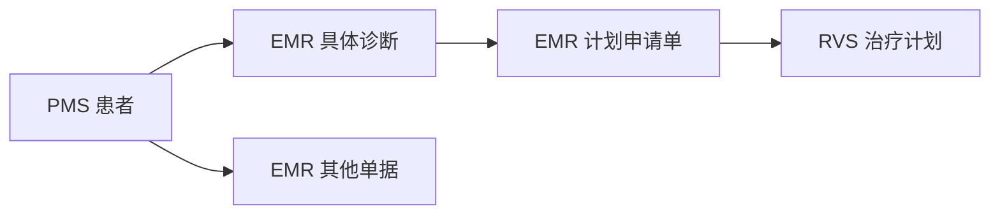

# OIS 全局搜索原型需求

工作人员通过一个入口搜索 PMS、EMR、RVS 的患者及业务记录，查看命中内容，并打开原始记录及其关联详情。

## 数据与业务关联

原型使用三个实际的 PostgreSQL 数据库和虚构业务数据，页面明确标示“演示数据”。PMS 提供患者，EMR 提供诊断、计划申请单及其他单据，RVS 提供治疗计划。

每张计划申请单关联一条具体诊断，每份治疗计划关联一张申请单。链上记录必须属于同一患者。姓名可以重复；患者和各类记录使用独立标识识别，不能凭姓名或相似编号合并。

下一次完整同步成功后，已删除、已作废的记录不参与新搜索。患者被删除后，其全部记录退出新结果；患者仍可用时，其他记录按自身是否可用独立参与搜索。诊断或申请单失效不级联改写子记录；打开已失效的关联目标时说明原因。

## 全局搜索

### 搜索对象与结果

| 对象 | 可搜索内容 | 结果展示 | 点击去向 |
|---|---|---|---|
| 患者 | 姓名、放疗号 | 姓名、放疗号、性别、出生日期 | 原型内患者详情 |
| 诊断 | 规范诊断名称、已保存编码、拆分的诊断字段（临床描述、备注、方法等）；患者姓名、放疗号 | 诊断名称、确认状态、诊断日期、所属患者、来源及命中内容 | EMR 诊断详情及关联申请单 |
| 计划申请单 | 标题、拆分的申请字段（说明、医嘱、技术、设备等）；患者姓名、放疗号 | 标题、申请单号、申请日期、所属患者、关联诊断及命中内容 | EMR 申请单详情及关联计划 |
| 治疗计划 | 计划编号、名称、备注；患者姓名、放疗号 | 名称、编号、计划状态、所属患者、来源及命中内容 | RVS 计划详情及来源申请单 |
| 其他单据 | 单据类型、标题、按单据类型拆分的字段；患者姓名、放疗号 | 标题、类型、单据日期、所属患者、来源及命中片段 | EMR 对应单据详情 |

各对象拆分后的完整字段清单和匹配方式见 [可搜索字段](search-fields.md)。文字命中标明具体字段名；拆分字段里找不到匹配内容时，仍按合并正文展示。

计划申请单只作为“计划申请单”结果展示，不重复列入“其他单据”。同一患者的不同记录分别展示。

### 搜索范围与展示

- 顶部提供统一的全局搜索入口。
- 搜索范围明确显示“全部患者”或“当前患者：姓名／放疗号”。进入患者详情不会悄悄切换范围；没有选定患者时不能启用当前患者范围。
- 来源可选择全部来源、PMS、EMR。记录分类为全部记录、患者、诊断、定位申请单、复位申请单、计划申请单、后装申请单、一站式申请单、检查预约单、全身放疗申请单、治疗单、自定义单据。全部记录是这些分类的合计。已中止单据不单列。结果数量按业务记录计算，分类计数与本次关键词、患者范围和来源条件一致。
- 单个汉字可匹配姓名、标题、单据类型或正文中的对应字，并显示高亮。多字查询按完整查询词检索。
- 完整编号的精确匹配优先；姓名、标题及正文命中提供相应上下文。放疗号保留前导零。
- 输入关键词后可自动查询，也可按 Enter 立即查询。空白输入显示搜索提示，未命中时显示无结果；搜索失败提供重试，不能显示成无结果。
- 正文提及可以被搜索命中，例如“疑似鼻咽癌”或“已排除鼻咽癌”；结果保留上下文，不能仅凭关键词把患者标记为确诊。

### 按确诊日期和处方分次数找患者

在全局搜索框输入「最近三个月确诊鼻咽癌、处方不少于 20 次」时，页面显示识别出的诊断、确诊日期范围和分次数下限。每位符合条件的患者显示一次，可打开患者详情。患者须有范围内的确诊记录，且至少一张直接关联该诊断的有效计划申请单达到分次数下限。无匹配患者时仍显示筛选条件。

用户输入「最近10个月确诊鼻咽癌」时，页面按确诊日期和病种编码查找患者，显示实际日期范围和编码体系。每位符合条件的患者显示一次。

## 详情、跳转与返回

患者详情按诊断、申请单、计划和其他单据组织记录。诊断详情可打开对应申请单；申请单可打开具体诊断及关联计划；计划可打开来源申请单。所有跳转保留所属患者信息。

搜索结果点击后进入对应记录，并定位命中的字段或正文片段。详情读取当前来源记录；正文已修改而无法定位原片段时，展示最新内容并提示。查询时的命中内容保持原样，用户可刷新结果。

返回结果时保留关键词、患者范围、来源、类型、页码和浏览位置。打开或查看记录不改变业务状态。目标记录已删除、已作废、来源不可用或关联异常时，分别说明原因并允许返回；不能改为打开同名记录。

## 数据更新与异常

源库修改后，通过手动同步更新可查询内容。页面显示最近成功同步时间，并可以点击「同步数据」发起一次完整同步；命令行执行同一同步仍然可用。新增、修改、删除、作废及关联变化在下一次完整同步成功后反映到搜索结果。

姓名或放疗号更正时，关联结果中的患者信息一起更新；诊断状态、申请单所属诊断、计划所属申请单变化时，搜索结果中的状态及关联信息一起更新。

尚未完成首次同步时，显示“尚未同步数据”。同步失败时保留上次完整数据并显示失败提示和上次成功时间；有来源读取失败、引用错误或写入失败时，不把部分数据作为新的完整结果发布。来源读取失败不能被解释为该来源没有记录。

查询失败、无匹配、尚未同步和旧批次数据分别提示。同步后已有查询保持原结果并提示刷新，重新查询后使用新数据。

## 验收结果

| 场景 | 预期结果 |
|---|---|
| 搜索放疗号 | 找到同一患者在不同来源的记录，来源和对象类型清楚，前导零保留 |
| 搜索正文关键词 | 展示真实命中片段，进入正确记录并定位 |
| 搜索同名患者 | 按独立身份和放疗号区分，不混合记录 |
| 同一患者有多条记录 | 分别展示，各自打开正确详情 |
| 限定当前患者、来源或类型 | 只返回相应范围的匹配记录，分类计数与条件一致 |
| 正文包含疑似、已排除或家族史 | 保留原文上下文，不把关键词命中解释为确诊 |
| 从计划追溯申请单和诊断 | 打开具体关联记录，始终显示所属患者 |
| 修改或移除业务记录后同步 | 搜索结果、记录数量和展示内容按新数据变化 |
| 关联父级失效而当前记录仍有效 | 当前记录可独立命中，打开失效目标时说明原因 |
| 打开详情后返回 | 恢复原查询和浏览位置 |
| 查询期间完成新同步 | 原结果保留并提示刷新，同次分页不混用新旧数据 |
| 搜索、同步或详情读取失败 | 显示对应失败状态，保留输入和返回入口，不伪装为无结果 |

页面操作见 [交互流程](interaction-flows.md)，当前可搜索字段见 [可搜索字段](search-fields.md)，字段与索引见 [数据模型](data-model.md)，场景准备和验收映射见 [测试用例](test-cases.md)。

### 按定位申请单字段查找

在全局搜索框输入成像方式或定位部位，结果页显示识别出的条件。组合输入时，同一张定位申请单必须同时满足两项。旧批次缺少独立字段时，结果页提示从源系统重新同步。
