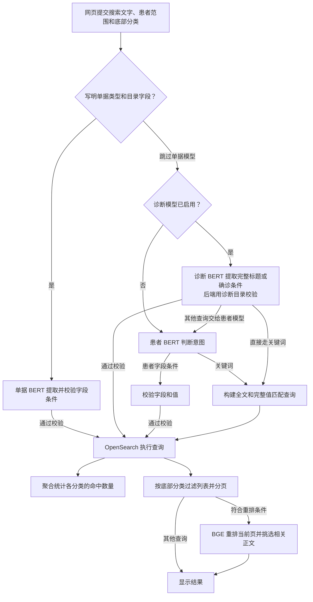

# OIS 全局搜索说明

同步程序把业务记录转换成搜索文档，OpenSearch 按字段定义建立索引。用户提交查询后，后端决定用关键词匹配还是按字段筛选，再把查询交给 OpenSearch。底部分类决定列表显示哪些记录。

## 数据怎么进索引


## 索引、文档、字段和别名

把业务数据库的一条诊断记录转换成搜索文档时，同步程序挑出需要搜索或返回的字段。下面是一条简化的诊断文档，ID 为示例值。

```json
{
  "id": "example-diagnosis",
  "recordType": "diagnosis",
  "patientId": "example-patient",
  "title": "鼻咽后壁恶性肿瘤",
  "bodyText": "诊断说明中提到鼻咽癌",
  "code": "C11.1",
  "businessDate": "2026-07-30"
}
```

- **文档（document）**是 OpenSearch 一次命中和返回的记录。上面的 JSON 是一条文档，`title` 和 `code` 是两个字段。文档的 OpenSearch 标识为 `_id`，`_source` 保存写入时的文档内容，查询可以控制返回哪些字段。
- **索引（index）**是一批文档及其搜索结构。OIS 的同一批索引里有患者、诊断和申请单，查询用 `recordType` 区分它们。患者文档和诊断文档可以通过 `patientId` 对应到同一位患者。
- **别名（alias）**是搜索程序用来定位当前物理索引的固定名称。本项目使用 `ois-records`。
- **Settings（索引设置）**定义整个索引的运行方式。项目配置一个主分片、零个副本。分片是 OpenSearch 存放文档和执行查询的单元，副本是主分片的复制。批量导入时，项目先暂停自动刷新，写完后手动刷新，让新文档可被查询，再做发布校验。 [批次发布代码](../server/sync.ts)

### 为什么重建索引时要用别名

每次同步会创建一个带批次号的物理索引。搜索程序通过 `ois-records` 找到当前批次，因此发布新批次时，程序可以继续使用同一个入口。

| 重建阶段 | `ois-records` 指向 | 新发起的搜索使用 |
| --- | --- | --- |
| 开始重建前 | 旧索引 | 旧批次 |
| 写入和校验新索引期间 | 旧索引 | 旧批次 |
| 新索引校验通过并切换别名后 | 新索引 | 新批次 |

如果新索引写入或校验失败，同步程序保留旧索引的指向。切换别名只更新指向关系，数据已经提前写入新索引。

在 Dashboards 的 Dev Tools 执行 `GET _alias/ois-records`，返回结果的最外层键就是当前物理索引名，例如 `ois-records-20261112021545637-c2bf6b75`。 [批次发布代码](../server/sync.ts)

## Mapping 怎么影响查询

**Mapping 是索引的字段说明。** 它告诉 OpenSearch 用什么类型处理某个字段，以及文字该怎样分词。查询再指定这次要匹配的值、比较符和范围。

| 字段类型 | OIS 示例 | 查询示例 |
| --- | --- | --- |
| `text` | 诊断标题 `title`、说明 `bodyText` | 搜「鼻咽癌」时，`match` 或 `multi_match` 按分析后的词匹配。 |
| `keyword` | 诊断编码 `code`、记录类型 `recordType` | 用 `term` 精确匹配 `C11.1` 或 `diagnosis`。用 `terms` 匹配一组允许值。 |
| 数值 | 单据的 `recordFields.numericValue` 是 `double` | 用 `range` 的 `gte: 20` 筛出总次数至少为 20 的单据。 |
| `date` | `businessDate` 或 `diagnosisFilters.diagnosedOn` | 用 `range` 的 `gte` 和 `lte` 限定日期起止，两端都包含。 |
| `nested` | `recordFields`、`patientFields`、`diagnosisFilters` | 用 `nested` 查询约束条件必须满足在同一个子对象上。 |

**同一个字段可以有多种索引方式。** 例如 `title` 用于常规文字搜索，`title.keyword` 用于完整标题匹配，`title.han` 用于单字查询。它们都来自写入文档时的同一个 `title` 值。

**Analyzer（分词器）**决定文字拆成什么词。用当前索引的 `_analyze` 实测，「鼻咽癌」在 `title` 上拆成「鼻咽」「咽癌」，在 `title.han` 上拆成「鼻」「咽」「癌」。用户只输一个汉字时，后端会把 `.han` 子字段纳入匹配。

### 同一份数据，换字段或查询写法会怎样

下面截取项目中 `title` 的实际 Mapping。同步只写入一份标题。OpenSearch 按这里的定义，用三种方式为标题建索引。

```json
{
  "title": {
    "type": "text",
    "analyzer": "cjk",
    "fields": {
      "keyword": { "type": "keyword" },
      "han": { "type": "text", "analyzer": "standard" }
    }
  },
  "code": { "type": "keyword" }
}
```

假设写入的标题是「鼻咽后壁恶性肿瘤」，编码是 `C11.1`。标题的常规索引含「鼻咽」这样的词，单字索引含「鼻」，而完整值索引保存整个标题。查询指定哪个字段，就使用那一种索引方式。

| 查询 | OpenSearch 比较什么 | 当前批次诊断文档实测 |
| --- | --- | --- |
| `match` 查询 `title`，输入「鼻咽」 | 先分析输入，再与标题中的词匹配。 | 114 条 |
| `term` 查询 `title`，值是「鼻咽」 | 直接查标题索引里有没有这个完整词项。 | 114 条 |
| `term` 查询 `title.keyword`，值是「鼻咽」 | 直接查完整标题等于「鼻咽」的记录。 | 0 条 |
| `term` 查询 `title`，值是「鼻」 | 在常规标题索引里查单字词项。 | 0 条 |
| `term` 查询 `title.han`，值是「鼻」 | 在单字索引里查同一个值。 | 123 条 |
| `term` 查询 `code`，值是 `C11.1` 或 `C11` | 分别比较完整编码。 | 27 条和 0 条 |

用下面的查询可复测单字。将 `title.han` 改成 `title`，同一批数据会从 123 条变为 0 条。这些数字只统计诊断标题，网页全局搜索还会匹配说明等其他字段。

```text
GET ois-records/_search
{
  "size": 0,
  "track_total_hits": true,
  "query": {
    "bool": {
      "filter": [
        { "term": { "recordType": "diagnosis" } },
        { "term": { "title.han": "鼻" } }
      ]
    }
  }
}
```

### Mapping、同步和查询各管哪一步

- **同步决定有什么值。** 「总次数」必须由同步从源列取出并写入 `numericValue`。旧文档如果只存了展示值 `"20"`，新增数值字段定义也不会自动补出数值。范围查询要等这些文档重新导入。
- **Mapping 决定值怎么入索引。** `numericValue` 按数字比较，`businessDate` 按日期比较，`recordFields.value` 按完整值匹配。同一条单据可以同时保留展示值和用于比较的数值。
- **查询决定这次用哪个字段、怎么比。** 「总次数 ≥ 20」用 `range` 查 `numericValue`。「编码是 C11.1」用 `term` 查 `code`。把比较符从 `gte` 换成 `lt` 时，只改查询就能得到不同的结果。

**嵌套字段保留一对值的关系。** 一张单据可以同时有「总次数 = 19」和「另一数值字段 = 25」。`nested` 让「字段名是总次数」和「数值 ≥ 20」在同一项上检查，所以这张单据不命中。按 ICD 编码和确诊日期找患者时，同样要求两个条件落在同一条确诊诊断上。 [字段定义](../server/mapping.ts) · [查询构造](../server/search.ts)

### 字段变更后要不要重建

| 改动 | 在本项目怎么做 |
| --- | --- |
| 字段和值都已入索引，只改查询条件 | 修改查询并验证命中。例如把「至少 20」改成「小于 20」。 |
| 新增一个可搜索字段 | 定义字段并让同步写入值。OIS 使用 `dynamic: strict`，未声明的字段写入时会被拒绝。用新批次让历史数据也获得该字段。 |
| 已有字段需要改类型或换索引时的分词方式 | 用新 Mapping 建索引，再重新写入数据。查询通过别名切到已校验的新批次。 |

排查搜不到时，先用 `_mapping` 看字段定义，再查看一条预期命中的文档是否有值。文字匹配可用 `_analyze` 核对词项，最后检查查询有没有选对字段和比较方式。

## 查询里的匹配、排序和分类

| 概念 | 用 OIS 搜索解释 |
| --- | --- |
| Query DSL | 后端发送给 OpenSearch 的 JSON 查询。下面的总次数示例展示 `bool`、`term`、`range` 和 `nested` 如何组合。 |
| `bool.filter` | 条件必须满足，适合记录类型、患者 ID、日期和数字范围。计划申请单的总次数筛选就用它。 |
| `bool.should` 和相关性分数 `_score` | 关键词查询同时尝试正文、名称和完整编号等匹配方式，至少满足其中一种。项目还把完整编号或编码精确命中的结果优先排列，再按相关性分数排序。 |
| 聚合（`aggs`） | 对匹配的记录分组计数。搜「鼻咽癌」命中 22 条，其中 13 条属于诊断。 |
| 分类过滤（`post_filter`） | 点「诊断」后，只把 13 条诊断送进结果列表。聚合仍基于原来的 22 条命中，各标签数字可继续显示。 |
| 分页（`from`、`size`） | 指定列表从哪里开始取、取多少条。页面每页 20 条，总数来自 OpenSearch 的命中统计。 |
| 高亮（`highlight`）与 `inner_hits` | 高亮返回命中的文字片段，例如诊断说明里的「鼻咽癌」。`inner_hits` 返回匹配的嵌套项，例如「总次数 = 25」，用于显示实际命中值。 |

以下命令可以在 Dashboards 的 Dev Tools 分别执行，查看别名、字段定义和分词结果。

```text
GET _alias/ois-records

GET ois-records/_mapping

POST ois-records/_analyze
{
  "field": "title",
  "text": "鼻咽癌"
}
```

## 跟一张计划申请单走完整条链路

假设源系统里的计划申请单有 `total_treat_number = 20`。下面用虚构 ID，只保留和示例有关的字段。

1. **同步取值。** 字段目录把源列 `total_treat_number` 对应到业务名「总次数」，并标为数值字段。同步保留原始显示值 `"20"`，同时在发布索引时补上数值 `20`。
2. **写入索引。** 这张申请单写成一条文档，单据类型为「计划申请单」。它和其他类型的文档可以在同一个索引里。
3. **生成查询。** 用户搜「总次数不少于 20 次的计划申请单」时，BERT 提取字段、比较符和值。后端核对字段归属及类型，再生成 OpenSearch 查询。
4. **返回命中。** OpenSearch 在同一条嵌套字段中同时检查「字段名是总次数」和「数值 ≥ 20」。后端拿到命中的字段值，页面显示查询条件「总次数 ≥ 20」和每张单据的实际次数。打开详情时，用来源和记录 ID 找原记录。

搜索文档节选如下。

```json
{
  "id": "example-plan-request",
  "recordType": "plan_request",
  "documentType": "计划申请单",
  "recordFields": [
    { "label": "总次数", "value": "20", "numericValue": 20 }
  ]
}
```

Mapping 对这段数据的定义如下。实际定义还给 `value` 配了用于字段内文字匹配的子字段。

```json
{
  "recordFields": {
    "type": "nested",
    "properties": {
      "label": { "type": "keyword" },
      "value": { "type": "keyword" },
      "numericValue": { "type": "double" }
    }
  }
}
```

以下是从项目查询构造代码简化出来的 OpenSearch JSON，可在 Dashboards 的 Dev Tools 执行。它省略了分类计数、排序和分页，保留了决定命中的部分。

```text
GET ois-records/_search
{
  "query": {
    "bool": {
      "filter": [
        { "term": { "documentType.keyword": "计划申请单" } },
        {
          "nested": {
            "path": "recordFields",
            "query": {
              "bool": {
                "filter": [
                  { "term": { "recordFields.label": "总次数" } },
                  { "range": { "recordFields.numericValue": { "gte": 20 } } }
                ]
              }
            },
            "inner_hits": { "name": "simulationField0", "size": 3 }
          }
        }
      ]
    }
  }
}
```

`gte` 包含 20，所以总次数为 19 的计划申请单不会命中。后装申请单即使总次数是 20，也会被单据类型条件排除。同一张计划申请单如果总次数是 19、另一个数值字段是 25，嵌套查询也会将其排除。若搜索改成「总次数小于 10 次」，后端只需在查询中换成 `lt: 10`。 [字段目录](../server/sources/record-fields.ts) · [字段定义](../server/mapping.ts) · [同步和批次发布](../server/sync.ts) · [查询构造](../server/search.ts)

## 一次搜索怎么执行



后端依次检查单据、诊断、患者三条路径。结构化条件通过校验后进入查询，模型要求补充条件时页面显示提示。单据模型需要明确的单据类型和目录字段。启用新版诊断模型后，由模型识别完整诊断标题、确诊日期条件或普通搜索意图。后端从当前索引批次核对标题和病名。底部分类通过 OpenSearch 的 `post_filter` 作用于列表，聚合计数仍按分类过滤前的命中计算。 [模型调用与查询](../server/search.ts) · [模型校验与重排](../server/search-models.ts)

| 输入 | 后端怎样查 | 页面怎样显示 |
| --- | --- | --- |
| 鼻咽癌 | 患者 BERT 判为关键词，OpenSearch 搜名称、正文等字段。 | 本地快照中命中 22 条记录，点「诊断」显示其中 13 条。高亮可以出现在诊断说明里。 |
| 最近10个月确诊鼻咽癌 | 诊断 BERT 提取病名和月份，OpenSearch 按日期范围及 ICD-10、ICD-11 编码集合匹配患者的确诊记录。 | 本地快照验收命中 14 位患者，同一患者只显示一次。 |
| 主诊医生为颜艳 | 患者 BERT 提取字段和值，OpenSearch 精确匹配同一项患者字段。 | 本地快照验收命中 784 位患者，页面显示识别出的医生条件。 |
| 总次数不少于20次的计划申请单 | 单据 BERT 提取字段和比较符，OpenSearch 限定单据类型并比较数字。 | 页面显示「总次数 ≥ 20」，每张命中单据显示实际次数。 |

关键词和字段筛选使用的查询也不同。「鼻咽癌」走 `multi_match` 等匹配条件，标题和说明都可能命中，OpenSearch 返回文字高亮。搜完整编码 `C11.1` 时，查询还会在 `code` 字段检查完整值，并优先排列编码精确命中的记录。

「最近10个月确诊鼻咽癌」返回的是患者。同步时，患者文档中的 `diagnosisFilters` 已保存按该患者归集的确诊条目。OpenSearch 在同一条诊断里同时核对编码和日期，再返回患者文档。因此同一患者有两条匹配诊断时，结果里仍只有一位患者。 [确诊记录归集](../server/diagnosis-filters.ts)

当前 BGE 用于重排 OpenSearch 已召回的当前页结果，并选择相关正文。BGE Embedding 加 k-NN 属于向量召回方案，目前作为待评估方案。

## 怎么制定搜索字段

先写一句用户会输入的查询，再确定字段用途。一个源字段可以同时用于展示、全文和精确筛选。

| 用户要做什么 | 字段怎么处理 |
| --- | --- |
| 搜「屏气」，找到提到它的单据 | 将扫描备注、固定备注等文本汇总到正文。源数据可保留独立字段供展示和核对。 |
| 只搜扫描备注里的「屏气」 | 保留扫描备注的字段名和文本，支持指定字段内的匹配。 |
| 按放疗号找记录，或按主诊医生筛患者 | 保存完整值。编号保留前导零，医生姓名与对应字段名成对保存。 |
| 筛总次数 ≥ 20，或按确诊日期筛患者 | 另存可比较的数字或日期，并校验单位、空值和比较边界。 |
| 查看完整单据或核对原始值 | 根据来源和记录 ID 回查详情。索引保留搜索结果需要展示的字段和命中说明。 |

具体字段以[当前字段清单](search-fields.md)为准。

## 新增搜索内容的工作量

| 改动 | 主要工作 |
| --- | --- |
| 已索引的内容增加查询方式 | 核对 Mapping 和数据覆盖，调整查询及命中说明。若现有字段已具备所需类型，通常直接复用。 |
| 新字段加入全文 | 确认源字段、取值和权限，更新同步转换与命中展示，重跑同步或回填历史记录。 |
| 新增精确、数值或日期筛选 | 确认数据类型、比较方式和所属单据，更新字段目录及查询。自然语言输入还要验收 BERT 的字段和值提取，模型表现不足时再补训。若现有索引缺少正确类型，需要重建索引。 |
| 新增病种叫法或跨 ICD 归并 | 核对术语、别名和编码集合，按诊断记录与患者 ID 对照验收。同步后的正式诊断名已可进入目录。 |
| 新增一类业务记录 | 接入数据源、定义字段和患者关联、实现详情跳转及分类，再验证同步与历史数据。 |
| 增加向量召回 | 接入 Embedding、给正文生成向量、建立 k-NN 索引、合并关键词与向量候选，并评估相关性与耗时。 |

验收至少准备一个应命中样本、一个不应命中样本。数值筛选加一组边界值，同名字段加一组跨单据对照。通过浏览器核对实际命中值，必要时用记录 ID 与源数据逐条对比。


### 用「固定备注」估算改动

1. **只要求搜到备注里的文字。** 先检查快照是否已取到固定备注，及它是否已进入正文。两项都满足时，先拿现有查询验收。若正文漏了该列，改同步投影和字段展示，再回填旧批次。
2. **要求只搜固定备注。** 把「固定备注包含屏气」写成验收用例。确认备注以独立的字段名和值写入 `recordFields`，并由查询同时匹配字段名和文字。还要用「仅扫描备注写了屏气」的单据验证筛选范围。
3. **要求用自然语言直接筛。** 确认单据类型、字段名和匹配方式已进模型目录。拿用户实际说法复测 BERT。若模型总把固定备注提成扫描备注，补的是模型样本和回归用例。若模型提对了但 OpenSearch 搜不到，先检查快照字段、Mapping 和查询。

评估工时时，把**开发改动、历史数据重跑、验收**分别列出来。能复用既有字段类型时，主要成本通常在确认源值和验收。需要新增索引结构、接新数据源或训练模型时，再单独估算这些工作。用一小批真实快照测出导入速度后，再估全量回填时间。
